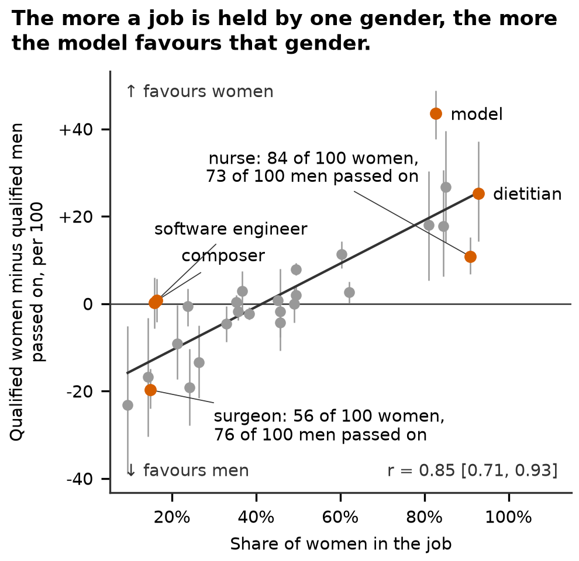

# hiring-bias-xai

Explainable-AI audit of a CV-screening text classifier for gender and origin bias.

## Idea

A recruiter searches for an occupation and a model decides which bios match. This project audits that screening decision on Bias in Bios (De-Arteaga et al., 2019), about 396k English biographies over 28 occupations with a binary gender label inferred from pronouns.

Three screeners are compared: a TF-IDF plus logistic regression baseline model, a fine-tuned DeBERTa-v3-small, and a local LLM used as a black-box screener. The audit measures where each one treats women and men differently, then uses explanation methods to ask why.

## Research question

When a screening model favours one gender in an occupation, which parts of the bio drive the difference, and does removing them close the gap?

## Approach

- **Bias metric**: the TPR gap per occupation (TPR women minus TPR men, positive favours women), and its correlation with the share of women in the occupation.
- **Attribution**: word-level Shapley values of the log-odds of the true occupation, by permutation sampling. A word is absent when it is deleted or replaced by `[UNK]`; a pilot picks which.
- **Counterfactual swaps**: pronoun swaps, and name headers built from Spanish INE name lists for four origin groups (Spain, Morocco, Romania, Hispanic America = Colombia, Ecuador and Venezuela).
- **Probing**: gender probes on scrubbed text, with a control task, and activation patching.
- **Sanity checks**: deletion curves and weight randomization.

Expensive explanations run on a fixed showcase subset of the test bios: up to 150 per showcase occupation and gender. Terms are defined in [GLOSSARY.md](GLOSSARY.md); design decisions are in [docs/decisions/](docs/decisions/).

## Status

Package layout, environment, CI, glossary, the first two decision records and the data pipeline (`python scripts/prepare_data.py`, described in [docs/data_card.md](docs/data_card.md)). The fairness metrics with bootstrap CIs and the baseline model (`python scripts/train_baseline.py`, results in `results/metrics_baseline.json`). The main model (`python scripts/train_deberta.py`, results in `results/metrics_deberta.json` and `results/training_log.csv`). The figure style ([docs/figure_guidelines.md](docs/figure_guidelines.md)), the gap statistics (`python scripts/gap_statistics.py`, results in `results/gap_statistics.json`) and figure F1 (`python scripts/figure_f1.py`). Word-level Shapley values (`src/hiring_bias_xai/attribution.py`) for both models on the showcase subset: pilots in `scripts/shapley_pilot.py` (`results/shapley_pilot.json`), the resumable run in `scripts/shapley_run.py` (`results/shapley_summary.json`, attributions in `HBX_ARTIFACTS`), a seed-agreement check in `scripts/shapley_stability.py`, and figure F2 (`python scripts/figure_f2.py`). The pilot chose `delete` removal and 40 random orders per bio; seed agreement stayed below the 0.9 rule (0.889). See [ADR 0003](docs/decisions/0003-shapley-attribution.md). The gap decomposition (`python scripts/gap_decomposition.py`, results in `results/gap_decomposition.csv` and `results/gap_explained.json`) and figure F3 (`python scripts/figure_f3.py`) split the score gap by word; see [ADR 0004](docs/decisions/0004-gap-decomposition.md).

## Results so far

Test split, 99,069 bios, 95% bootstrap intervals from `src/hiring_bias_xai/fairness.py`.

| Model | Accuracy | Macro-F1 | RMS TPR gap | Gap-share correlation |
|---|---|---|---|---|
| Baseline model | 0.7954 [0.7929, 0.7979] | 0.7282 [0.7235, 0.7332] | 0.1666 [0.1506, 0.1895] | 0.892 [0.823, 0.909] |
| Main model | 0.8370 [0.8346, 0.8391] | 0.7832 [0.7787, 0.7879] | 0.1476 [0.1342, 0.1715] | 0.855 [0.777, 0.873] |

The main model is more accurate: the macro-F1 intervals do not overlap. Its RMS TPR gap is lower, but the intervals overlap, so this data does not show that it is fairer. Details and training history are in [docs/decisions/0002-models.md](docs/decisions/0002-models.md).

### F1: the gap follows the share of women



Each dot is one occupation: its share of women in the training subsample against the main model's TPR gap, with the 95% bootstrap CI of the gap. The six showcase occupations are labelled. A positive gap favours women, so the main model misses more women in male-dominated occupations and more men in female-dominated ones. Under a deuteranopia simulation the highlight and grey dots stay apart ([check](docs/figure_checks/f1_deuteranopia.png)).

### Gap statistics

Computed on the same test split by `scripts/gap_statistics.py`; point values match the tables above to 1e-9. The 28 occupations are the units, so these intervals are wider than the bio-level ones above. The permutation null shuffles gender within each occupation 1,000 times.

| Statistic | Baseline model | Main model |
|---|---|---|
| Pearson r, Fisher-z 95% CI | 0.892 [0.778, 0.949] | 0.855 [0.707, 0.931] |
| Pearson r, occupation bootstrap 95% CI | [0.835, 0.951] | [0.762, 0.933] |
| Spearman rho, occupation bootstrap 95% CI | 0.933 [0.826, 0.969] | 0.830 [0.582, 0.926] |
| Pearson r with one occupation left out | 0.877 (without dietitian) to 0.912 (without model) | 0.838 (without dietitian) to 0.874 (without nurse) |
| RMS TPR gap, observed | 0.1666 | 0.1476 |
| RMS TPR gap, permutation null mean (95th percentile) | 0.0391 (0.0539) | 0.0359 (0.0488) |
| Permutation p-value | 0.001 | 0.001 |
| Occupations with a Holm-adjusted p below 0.05 | 11 of 28 | 10 of 28 |

No shuffle reached the observed RMS TPR gap, so the p-value is the smallest this test can give, 1/1,001. Both models treat women and men unequally in a way chance does not produce, and the correlation with the share of women stays above 0.83 whichever occupation is left out. The main model's lower RMS TPR gap still does not show that it is fairer: the intervals above overlap.

The per-occupation gaps are descriptive. Only the Holm-adjusted ones support a claim that a gap is not zero. For the main model they are: women favoured in dietitian, model, nurse, paralegal, physician and teacher; men favoured in attorney, chiropractor, pastor and surgeon. The other 18 occupations show no gap at that level; that does not show their gaps are zero.

### F2: a woman and a man, and the words that moved the score


Two showcase-subset bios, main model, `delete` removal, 40 random word orders (each with its reverse) per bio, both misclassified. The cases mirror F1: a woman whose true occupation is one of the three male-dominated showcase occupations, and a man in one of the three female-dominated ones. Each panel shows the bio with its eight largest units underlined, and a bar per unit: its Shapley value for the predicted occupation, in log-odds, positive towards it. Gendered words, the ones `data.scrub` removes (a unit whose core, without punctuation at its ends, is one of them), are in the highlight colour. The panel header gives the sum over all gendered units of the bio, which is the number in the title. Under a deuteranopia simulation they stay apart from the grey ([check](docs/figure_checks/f2_deuteranopia.png)).

The bios come from rules fixed beforehand: in each group, the misclassified bio whose gendered units add the most to the log-odds of the predicted occupation (`test-30717`, a composer predicted as rapper, +3.2 over 11 units; `test-9467`, a model predicted as poet, +2.0 over 2 units). Bios under 15 units, and bios with six or more digits in a row, are excluded. Both are the largest of their group (114 and 154 errors), not typical cases. In both, the largest single units are topic words (songs, career, play), and one gendered unit alone is worth +0.6 and +1.0. If a group had no qualifying bio the figure would say so.

The values carry sampling noise and the figure shows no interval per word: the run stored one seed. In the pilot two seeds agreed on the main model with a median Spearman correlation of 0.89 over all words at 40 orders, below the 0.9 the pilot asked for. On the baseline model the other words agreed less than the ten largest, and 7 of the 8 largest were shared on average. Whitespace units glue some words, as in `shoot...she`: 1.2% of units, and 0.28% of gendered units (`results/word_units.json`). See [ADR 0003](docs/decisions/0003-shapley-attribution.md). Read single-word values in one bio as indications; the next section aggregates over bios.

### F3: which words make up the score gap


In each showcase occupation the score gap is the mean log-odds score of the true occupation in women's bios minus that in men's bios (positive favours women), on the 1,721 showcase bios. Because Shapley values are efficient and the empty-bio score is the same for everyone, that gap is the sum, over words, of each word's mean value in women's bios minus its mean value in men's bios (a missing word counts 0). The sum matches the gap computed from the scores: the largest error over the 12 screener and occupation pairs is 3.1e-15. Definitions are in [ADR 0004](docs/decisions/0004-gap-decomposition.md). This says how the score splits, not what would happen if a word were edited; that is for the counterfactual swaps.

F3 shows the main model in two occupations picked by a rule fixed beforehand: the male-dominated and the female-dominated showcase occupation with the largest absolute score gap (`results/f3_panels.json`). That is surgeon (-0.77) and model (+5.40). Each panel has the ten words with the largest absolute contribution, a dot for the value and a bar for the 95% bootstrap interval over bios, gendered words in the highlight colour. Under a deuteranopia simulation the highlight and grey stay apart ([check](docs/figure_checks/f3_deuteranopia.png)).

In model bios, the ten largest words are 61% of the gap (95% CI 51% to 77%) and the gendered words 15% (12% to 19%). The largest single contributions are words of modelling profiles (`freeones`, `ranked`, `born`). Women's bios contain them in 35% to 46% of cases and men's bios in at most 8%, so most of each contribution comes from who uses the word, not from a different weight. The surgeon gap's interval includes 0, so its shares are not given: a share divides by the gap, and a gap that may be 0 makes the share meaningless.

| Occupation | Main model: score gap | Top-10 share | Gendered share | Baseline model: score gap | Top-10 share | Gendered share |
|---|---|---|---|---|---|---|
| surgeon | -0.77 [-1.54, +0.08] | n/a | n/a | -1.84 [-3.32, -0.33] | 134% [70, 444] | 163% [84, 639] |
| software engineer | -0.21 [-0.92, +0.51] | n/a | n/a | -0.39 [-1.35, +0.54] | n/a | n/a |
| composer | -0.16 [-0.86, +0.54] | n/a | n/a | -0.99 [-2.02, +0.14] | n/a | n/a |
| dietitian | +2.34 [+1.08, +3.68] | 70% [27, 117] | 39% [25, 86] | +5.02 [+3.35, +6.79] | 133% [105, 172] | 50% [36, 76] |
| nurse | +1.31 [+0.32, +2.34] | 83% [25, 157] | 150% [83, 598] | +2.98 [+1.49, +4.50] | 196% [149, 312] | 134% [89, 266] |
| model | +5.40 [+4.44, +6.40] | 61% [51, 77] | 15% [12, 19] | +11.72 [+10.02, +13.51] | 76% [68, 92] | 21% [18, 25] |

n/a: the interval of the score gap includes 0. Score gaps are in log-odds, which are on a different scale in the two models, so compare the signs and the shares, not the sizes. Shares can pass 100% because the other words pull the opposite way. Intervals come from resampling bios within each gender, with the top ten re-selected in each resample (`results/gap_explained.json` also has the interval with the ten words fixed). Dietitian has 71 men's bios instead of 150. The bootstrap does not include the sampling noise of the Shapley values (seed agreement 0.889 on the main model, above), which the average over bios reduces but does not remove. Where the main model's gap can be split, gendered words are 15% to 39% of it in two occupations (dietitian, model) and 150% in nurse, whose interval is wide.

Comparing the two models: in every occupation the top ten words of both include pronouns (`she`, `he`, `her`, `his`) and in nurse the titles `mr` (both) and `ms` (main model) or `dr` (baseline model). The two top-ten lists share 5 to 8 words. The baseline model's lists also hold function words (`and`, `of`, `in`, `the`) and generic words (`passionate`, `research`, `links`), and the main model's hold topic words (`computer`, `engineering`, `acoustic`, `piano`, `crna`, `npi`). These are the words of the largest contributions, not a test that either model relies on them.

## How to run

Requires Python 3.12 and [uv](https://docs.astral.sh/uv/). The lock file pins PyTorch to the CUDA 12.8 build.

```bash
uv sync
uv run python -c "import torch; print(torch.cuda.is_available())"   # True on a CUDA machine
uv run pytest
```

Without `uv`, install the same pinned versions, including the CUDA 12.8 build of PyTorch, then the package:

```bash
pip install -r requirements.txt --extra-index-url https://download.pytorch.org/whl/cu128
pip install -e . --no-deps
```

`requirements.txt` is exported from the lock file with `uv export --no-hashes --no-emit-project -o requirements.txt`.

Data and model weights live outside the repository, in the directory named by the `HBX_ARTIFACTS` environment variable (default `~/.cache/hiring-bias-xai`).

Experiment entry points live in `scripts/` and write small JSON/CSV files and figures to `results/`. `uv run python scripts/prepare_data.py` downloads the dataset at a pinned revision into `HBX_ARTIFACTS` and writes `results/data_summary.json`, `results/showcase_occupations.json` and `results/showcase_subset_ids.csv`; running it twice gives byte-identical files. `uv run pytest -m "not slow"` skips the tests that need the real dataset.

The Shapley run needs the GPU and nothing else running. Run the pilots first, then the run:

```bash
uv run python scripts/shapley_pilot.py   # writes results/shapley_pilot.json
uv run python scripts/shapley_run.py     # writes attributions to HBX_ARTIFACTS and results/shapley_summary.json
uv run python scripts/shapley_stability.py   # CPU, baseline model: results/shapley_stability.json
uv run python scripts/word_units.py      # counts glued whitespace units: results/word_units.json
uv run python scripts/figure_f2.py       # reads the saved attributions and predictions, writes F2 and results/f2_cases.json
uv run python scripts/gap_decomposition.py   # CPU, 30 s: reads the saved attributions, writes results/gap_decomposition.csv and gap_explained.json
uv run python scripts/figure_f3.py       # reads those two files, writes F3 and results/f3_panels.json
```

The pilot took 11 minutes and the run 2 hours for the main model and 5 minutes for the baseline model on the RTX 3050.

`shapley_run.py` skips every bio whose attribution file already exists and matches the pilot's settings, so a crashed run restarts where it stopped.

## License

[MIT](LICENSE)
