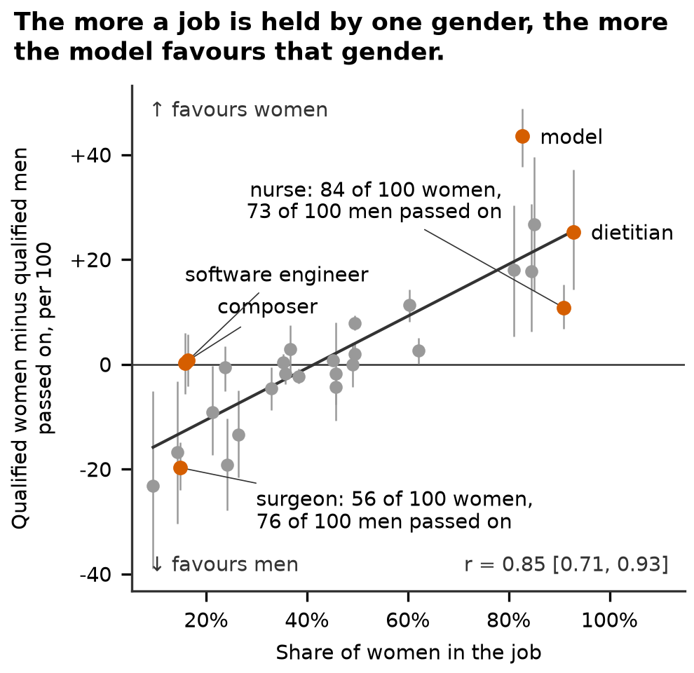
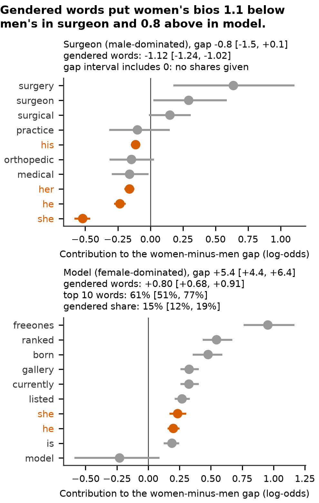
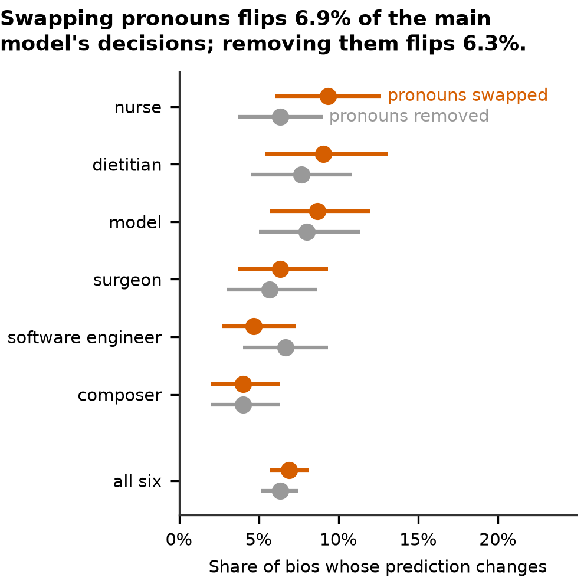

# Results

Every number here comes from a file in [`results/`](../results/) written by a script in [`scripts/`](../scripts/). Each section opens with the finding in one sentence, then the figure, then the details. Terms are defined in the [glossary](../GLOSSARY.md) and design choices in the [decision records](decisions/).

## Model performance

Test split, 99,069 bios, 95% bootstrap intervals from `src/hiring_bias_xai/fairness.py`.

| Model | Accuracy | Macro-F1 | RMS TPR gap | Gap-share correlation |
|---|---|---|---|---|
| Baseline model | 0.7954 [0.7929, 0.7979] | 0.7282 [0.7235, 0.7332] | 0.1666 [0.1506, 0.1895] | 0.892 [0.823, 0.909] |
| Main model | 0.8370 [0.8346, 0.8391] | 0.7832 [0.7787, 0.7879] | 0.1476 [0.1342, 0.1715] | 0.855 [0.777, 0.873] |

The main model is more accurate: the macro-F1 intervals do not overlap. Its RMS TPR gap is lower, but the intervals overlap, so this data does not show that it is fairer. Details and training history are in [docs/decisions/0002-models.md](decisions/0002-models.md).

## F1: the gap follows the share of women

**In short:** the more an occupation is dominated by one gender, the more the main model misses people of the other gender.

<p align="center"></p>

Each dot is one occupation: its share of women in the training subsample against the main model's TPR gap, with the 95% bootstrap CI of the gap. The six showcase occupations are labelled. A positive gap favours women, so the main model misses more women in male-dominated occupations and more men in female-dominated ones. Under a deuteranopia simulation the highlight and grey dots stay apart ([check](figure_checks/f1_deuteranopia.png)).

## Gap statistics

**In short:** the bias is not chance, and the correlation holds whichever occupation is left out.

Computed on the same test split by `scripts/gap_statistics.py`; point values match the tables above to 1e-9. The 28 occupations are the units, so these intervals are wider than the bio-level ones above. The permutation null shuffles gender within each occupation 1,000 times.

| Statistic | Baseline model | Main model |
|---|---|---|
| Pearson r, Fisher-z 95% CI | 0.892 [0.778, 0.949] | 0.855 [0.707, 0.931] |
| Pearson r, occupation bootstrap 95% CI | [0.835, 0.951] | [0.762, 0.933] |
| Spearman rho, occupation bootstrap 95% CI | 0.933 [0.826, 0.969] | 0.830 [0.582, 0.926] |
| Pearson r with one occupation left out | 0.877 (without dietitian) to 0.912 (without model) | 0.838 (without dietitian) to 0.874 (without nurse) |
| RMS TPR gap, observed | 0.1666 | 0.1476 |
| RMS TPR gap, permutation null mean (95th percentile) | 0.0391 (0.0539) | 0.0359 (0.0488) |
| Permutation p-value | 0.001 | 0.001 |
| Occupations with a Holm-adjusted p below 0.05 | 11 of 28 | 10 of 28 |

No shuffle reached the observed RMS TPR gap, so the p-value is the smallest this test can give, 1/1,001. Both models treat women and men unequally in a way chance does not produce, and the correlation with the share of women stays above 0.83 whichever occupation is left out. The main model's lower RMS TPR gap still does not show that it is fairer: the intervals above overlap.

The per-occupation gaps are descriptive. Only the Holm-adjusted ones support a claim that a gap is not zero. For the main model they are: women favoured in dietitian, model, nurse, paralegal, physician and teacher; men favoured in attorney, chiropractor, pastor and surgeon. The other 18 occupations show no gap at that level; that does not show their gaps are zero.

## F2: a woman and a man, and the words that moved the score

**In short:** in two wrong decisions, pronouns pushed the model toward the wrong occupation, though topic words weighed more.

<p align="center"></p>

Two showcase-subset bios, main model, `delete` removal, 40 random word orders (each with its reverse) per bio, both misclassified. The cases mirror F1: a woman whose true occupation is one of the three male-dominated showcase occupations, and a man in one of the three female-dominated ones. Each panel shows the bio with its eight largest units underlined, and a bar per unit: its Shapley value for the predicted occupation, in log-odds, positive towards it. Gendered words, the ones `data.scrub` removes (a unit whose core, without punctuation at its ends, is one of them), are in the highlight colour. The panel header gives the sum over all gendered units of the bio, which is the number in the title. Under a deuteranopia simulation they stay apart from the grey ([check](figure_checks/f2_deuteranopia.png)).

The bios come from rules fixed beforehand: in each group, the misclassified bio whose gendered units add the most to the log-odds of the predicted occupation (`test-30717`, a composer predicted as rapper, +3.2 over 11 units; `test-9467`, a model predicted as poet, +2.0 over 2 units). Bios under 15 units, and bios with six or more digits in a row, are excluded. Both are the largest of their group (114 and 154 errors), not typical cases. In both, the largest single units are topic words (songs, career, play), and one gendered unit alone is worth +0.6 and +1.0. If a group had no qualifying bio the figure would say so.

The values carry sampling noise and the figure shows no interval per word: the run stored one seed. In the pilot two seeds agreed on the main model with a median Spearman correlation of 0.89 over all words at 40 orders, below the 0.9 the pilot asked for. On the baseline model the other words agreed less than the ten largest, and 7 of the 8 largest were shared on average. Whitespace units glue some words, as in `shoot...she`: 1.2% of units, and 0.28% of gendered units (`results/word_units.json`). See [ADR 0003](decisions/0003-shapley-attribution.md). Read single-word values in one bio as indications; the next section aggregates over bios.

## F3: which words make up the score gap

**In short:** in surgeon, pronouns alone put women's bios clearly below men's; in model, the largest single word is not a gender word but the name of a site, `freeones`, found only in women's bios.

<p align="center"></p>

In each showcase occupation the score gap is the mean log-odds score of the true occupation in women's bios minus that in men's bios (positive favours women), on the 1,721 showcase bios. Because Shapley values are efficient and the empty-bio score is the same for everyone, that gap is the sum, over words, of each word's mean value in women's bios minus its mean value in men's bios (a missing word counts 0). The sum matches the gap computed from the scores: the largest error over the 12 screener and occupation pairs is 3.1e-15. Definitions are in [ADR 0004](decisions/0004-gap-decomposition.md). This says how the score splits, not what would happen if a word were edited; that is for the counterfactual swaps.

F3 shows the main model in two occupations picked by a rule fixed beforehand: the male-dominated and the female-dominated showcase occupation with the largest absolute score gap (`results/f3_panels.json`). That is surgeon (-0.77) and model (+5.40). Each panel has the ten words with the largest absolute contribution, a dot for the value and a bar for the 95% bootstrap interval over bios, gendered words in the highlight colour. Under a deuteranopia simulation the highlight and grey stay apart ([check](figure_checks/f3_deuteranopia.png)).

The title is the sum of the gap contributions of the gendered words (the gendered sum), which needs no division and so exists even where the total gap may be 0. In surgeon bios the main model's total gap (-0.77) has an interval that includes 0. The gendered words alone move it by -1.12 (95% CI -1.24 to -1.02): `she`, `he`, `her` and `his` all have negative contributions, and the occupation words (`surgery`, `surgeon`) have positive ones, which offset part of it. In model bios the gendered sum is +0.80 (+0.68 to +0.91) of a +5.40 gap. There the ten largest words are 61% of the gap (95% CI 51% to 77%) and the gendered words 15% (12% to 19%). Shares are not given for surgeon: a share divides by the gap, and a gap that may be 0 makes it meaningless.

The largest single word in the model panel is `freeones`, the name of a listing site for adult performers. It is in 54 of the 150 women's model bios of the showcase subset and in none of the 150 men's, and it contributes +0.96 (+0.76 to +1.17) of the main model's +5.40 gap (+3.65 of +11.72 for the baseline model). Part of the model gap therefore follows where the bios were scraped from, not gender words. The counts show that the word is only in women's bios; they do not show where the bios came from. `ranked`, `gallery` and `listed` are in a similar share of women's bios and in at most 2% of men's.

| Occupation | Main model: score gap | Gendered sum | Top-10 share | Gendered share | Baseline model: score gap | Gendered sum | Top-10 share | Gendered share |
|---|---|---|---|---|---|---|---|---|
| surgeon | -0.77 [-1.54, +0.08] | -1.12 [-1.24, -1.02] | n/a | n/a | -1.84 [-3.32, -0.33] | -3.00 [-3.24, -2.75] | 134% [70, 444] | 163% [84, 639] |
| software engineer | -0.21 [-0.92, +0.51] | +0.05 [-0.06, +0.16] | n/a | n/a | -0.39 [-1.35, +0.54] | -1.84 [-2.00, -1.68] | n/a | n/a |
| composer | -0.16 [-0.86, +0.54] | -1.09 [-1.21, -0.96] | n/a | n/a | -0.99 [-2.02, +0.14] | -2.75 [-2.99, -2.53] | n/a | n/a |
| dietitian | +2.34 [+1.08, +3.68] | +0.92 [+0.79, +1.04] | 70% [27, 117] | 39% [25, 86] | +5.02 [+3.35, +6.79] | +2.49 [+2.21, +2.83] | 133% [105, 172] | 50% [36, 76] |
| nurse | +1.31 [+0.32, +2.34] | +1.97 [+1.80, +2.14] | 83% [25, 157] | 150% [83, 598] | +2.98 [+1.49, +4.50] | +3.99 [+3.66, +4.31] | 196% [149, 312] | 134% [89, 266] |
| model | +5.40 [+4.44, +6.40] | +0.80 [+0.68, +0.91] | 61% [51, 77] | 15% [12, 19] | +11.72 [+10.02, +13.51] | +2.46 [+2.27, +2.64] | 76% [68, 92] | 21% [18, 25] |

Gendered sum: the summed gap contribution of the gendered words, positive when they put women's bios above men's. n/a: the interval of the score gap includes 0. Score gaps and sums are in log-odds, which are on a different scale in the two models, so compare the signs and the shares, not the sizes. Both models give gendered words a negative sum in the male-dominated occupations and a positive one in the female-dominated ones, except the main model in software engineer (the interval includes 0). Shares can pass 100% because the other words pull the opposite way. Intervals come from resampling bios within each gender, with the top ten re-selected in each resample (`results/gap_explained.json` also has the interval with the ten words fixed). Dietitian has 71 men's bios instead of 150. The bootstrap does not include the sampling noise of the Shapley values (seed agreement 0.889 on the main model, above), which the average over bios reduces but does not remove.

Comparing the two models: in every occupation the top ten words of both include pronouns (`she`, `he`, `her`, `his`) and in nurse the titles `mr` (both) and `ms` (main model) or `dr` (baseline model). The two top-ten lists share 5 to 8 words. The baseline model's lists also hold function words (`and`, `of`, `in`, `the`) and generic words (`passionate`, `research`, `links`), and the main model's hold topic words (`computer`, `engineering`, `acoustic`, `piano`, `crna`, `npi`). These are the words of the largest contributions, not a test that either model relies on them.

## F4: swapping pronouns against deleting them

**In short:** swapping *he* and *she* changes the main model's decisions about as often as deleting them. When a swap does change a decision, it usually moves it toward an occupation typical of the new gender. The baseline model reacts more strongly.

<p align="center"></p>

On the 1,721 showcase bios, `counterfactual.swap_gender` swaps he and she, him and her, his and hers and the titles Mr, Ms and Mrs, and each screener scores the original and the swapped bio. The removal control deletes the same words (`data.scrub`) instead. F4 shows the main model: per showcase occupation and pooled, the share of bios whose predicted occupation changes (the flip rate), swap in the highlight colour and removal in grey, with 95% bootstrap intervals over bios (1,000 resamples). Occupations are sorted by the swap flip rate, and the pooled row is labelled with its two rates (6.9% and 6.3%). The title says "no more often" because the pooled intervals overlap; the script words it "more often" or "less often" when they do not. Under a deuteranopia simulation the two colours stay apart ([check](figure_checks/f4_deuteranopia.png)). Design and alternatives are in [ADR 0005](decisions/0005-counterfactual-gender-swap.md); every number below is in `results/counterfactual_gender.csv` and `results/counterfactual_gender.json`.

A swap changes several tokens at once, so a flip does not prove that a model uses gender. The removal control and the residual-cue flags address that:

- **Residual cues.** The list of 92 gendered nouns (mother, husband, actress, businessman and so on, with plurals, in `counterfactual.RESIDUAL_NOUNS`) was fixed in code before any swapped bio was read. A bio is also flagged when it contains a first name from the public SSA name list (2,808 names, data card) that the entity recogniser reads as a person. 752 of the 1,721 bios are flagged: 225 by a noun, 631 by a first name, 104 by both. The name count is a lower bound, because the recogniser misses some lone names. The swap changes 1,689 bios and the removal 1,706; the others have no pronoun or title.
- **Hand check.** 50 swapped bios drawn at random (seed 42), original and swapped sentences read one by one (`results/counterfactual_hand_check.csv`). 3 are incoherent: 6% (Wilson 95% interval 2.1% to 16.2%). The three failures are a "his" before an opening quotation mark that became "hers", an object pronoun that referred to "the total man" and was swapped with the rest, and a swapped "her" that could now mean another person named in the text. Of the 47 coherent bios, 6 keep a gender cue (five first names and "husband"). Fifty bios give a wide interval, and the check was done once, on the code as delivered.

Flip rate, all bios and unflagged bios, with 95% intervals:

| Occupation | Bios (all / unflagged) | Main model, swap | Main model, removal | Main model, swap, unflagged | Main model, removal, unflagged |
|---|---|---|---|---|---|
| surgeon | 300 / 225 | 6.3% [3.7, 9.3] | 5.7% [3.0, 8.7] | 6.2% [3.1, 9.3] | 4.4% [2.2, 7.1] |
| software engineer | 300 / 203 | 4.7% [2.7, 7.3] | 6.7% [4.0, 9.3] | 5.4% [2.5, 8.9] | 7.4% [3.9, 10.8] |
| composer | 300 / 149 | 4.0% [2.0, 6.3] | 4.0% [2.0, 6.3] | 2.0% [0.0, 4.7] | 3.4% [0.7, 6.7] |
| dietitian | 221 / 115 | 9.0% [5.4, 13.1] | 7.7% [4.5, 10.9] | 10.4% [5.2, 15.7] | 6.1% [1.7, 10.4] |
| nurse | 300 / 110 | 9.3% [6.0, 12.7] | 6.3% [3.7, 9.0] | 11.8% [6.4, 18.2] | 9.1% [4.5, 14.5] |
| model | 300 / 167 | 8.7% [5.7, 12.0] | 8.0% [5.0, 11.3] | 9.0% [4.8, 13.2] | 8.4% [4.2, 12.6] |
| pooled | 1,721 / 969 | 6.9% [5.7, 8.1] | 6.3% [5.2, 7.5] | 7.0% [5.5, 8.6] | 6.3% [4.9, 7.8] |

| Occupation | Baseline model, swap | Baseline model, removal | Baseline model, swap, unflagged | Baseline model, removal, unflagged |
|---|---|---|---|---|
| surgeon | 12.7% [9.0, 16.3] | 8.7% [5.7, 12.0] | 12.4% [8.4, 16.9] | 8.9% [5.3, 12.9] |
| software engineer | 13.3% [10.0, 17.0] | 10.3% [7.3, 13.7] | 11.8% [7.4, 16.7] | 8.9% [5.4, 13.3] |
| composer | 9.7% [6.3, 13.0] | 6.7% [4.0, 9.7] | 8.7% [4.7, 13.4] | 5.4% [2.0, 8.7] |
| dietitian | 12.2% [8.1, 16.7] | 7.2% [4.1, 10.9] | 13.9% [7.8, 20.0] | 7.8% [3.5, 13.0] |
| nurse | 15.7% [11.7, 20.0] | 11.7% [8.3, 15.3] | 16.4% [10.0, 23.6] | 11.8% [6.4, 18.2] |
| model | 17.3% [13.0, 21.7] | 8.0% [5.0, 11.0] | 15.6% [9.6, 21.6] | 6.0% [3.0, 9.6] |
| pooled | 13.5% [12.0, 15.1] | 8.8% [7.6, 10.1] | 12.9% [10.8, 14.9] | 8.0% [6.4, 9.7] |

What the control shows:

- **Main model.** Pooled, the swap flips 6.9% of bios and the removal 6.3%, and the intervals overlap in every occupation and in both subsets. Deleting the pronouns moves the decision about as often as swapping them, so most flips come from the edit, and this data does not show a gender-specific sensitivity beyond it. The change in the log-odds of the true occupation is +0.03 (95% CI -0.01 to +0.08) for the swap and -0.01 (-0.04 to +0.02) for the removal.
- **Baseline model.** The swap flips 13.5% and the removal 8.8%, with separate pooled intervals; by occupation only model separates clearly (17.3% against 8.0%). The swap lowers the log-odds of the true occupation by 0.19 (-0.27 to -0.11) where the removal raises it by 0.13 (+0.08 to +0.18). The drop is largest in dietitian (-0.55, -0.77 to -0.34) and model (-0.56, -0.79 to -0.30), two of the three female-dominated occupations (nurse shows none, -0.01): giving those bios male pronouns costs the baseline model score that deleting the pronouns does not. That fits a model that reads female pronouns as evidence for these occupations; it does not show which words did it.
- **Flagged bios.** Leaving out the 752 flagged bios changes no conclusion: the pooled rates move by at most 0.8 points, and for every screener, occupation and condition the unflagged interval overlaps the one for all bios. In the unflagged subset the baseline model's pooled swap and removal intervals are still separate (12.9% [10.8, 14.9] against 8.0% [6.4, 9.7]).

Flip direction, swap only. Among flipped bios, the share whose new prediction has a training share of women that moves toward the new gender (a woman's bio turned male is toward when the share falls). This uses the same `share_women` as F1, so the two results are not independent. The six showcase occupations sit at the extremes of that share, so a flip out of nurse in a woman's bio can only lower it. The removal flips, read as if the new gender were the opposite one, give the reference:

| Screener | Toward, swap | Toward, swap, unflagged | Toward, removal (reference) |
|---|---|---|---|
| Main model | 88.2% [82.4, 93.7] of 119 flips | 85.3% [75.4, 93.0] of 68 | 71.6% [62.8, 80.0] of 109 |
| Baseline model | 94.8% [91.8, 97.4] of 233 | 95.2% [90.9, 98.4] of 125 | 83.6% [77.4, 89.3] of 152 |

Most flips go to an occupation with the opposite share of women whatever the edit; the swap sits above the reference for both screeners (about 17 and 11 points) with separate intervals. Per-occupation rows are in the csv; with 12 to 52 flips each they are wide, and the main model's software engineer rows (50.0% of 14 flips) show no direction.

Limits: 50 hand-checked bios cannot rule out failure types that are rare; the unflagged subset has no detected cue, not no cue; names and origin are out of scope here (the LLM audit, #12); the swap is binary and says nothing about non-binary people.

## F5: can we trust the Shapley values?

**In short:** removing the words Shapley ranks highest hurts the main model far more than removing random words, so the values point at words that matter. But the ranking of all the words in a bio is not stable: it changes with the removal and differs from leave-one-out, so single-word values are indicative, not exact.

<p align="center"></p>

Panel a is the main model's deletion curves: the fall in the log-odds of the true occupation as words are removed, MoRF in the highlight colour, random in light grey with its interval, LeRF in dark grey and dashed. Panel b is the agreement of the rankings in three checks, with 95% bootstrap intervals over bios. A short bar on each row marks the pass threshold of each measure, so the reader can see how far a check fell short. Every number is in `results/deletion_curves.csv`, `results/deletion_areas.json` and `results/stability.json`. Under a deuteranopia simulation the highlight and the greys stay apart ([check](figure_checks/f5_deuteranopia.png)). Each check had an expected outcome written in the code before it ran; a failed check is kept as it came out.

**Deletion curves** (`scripts/deletion_curves.py`, both screeners, the 1,721 showcase bios). Words are replaced by `[UNK]`. The attributions used `delete`, so the check does not reuse the removal that built the values. Words go in three orders: most relevant first (MoRF, by the signed Shapley value for the true occupation), least relevant first (LeRF) and 10 random orders per bio, seeded. The steps are 0%, 5%, ..., 50% of the bio's words, rounded half up to a whole word. At each step the script records whether the call is still the call on the full bio, and how far the log-odds of the true occupation have fallen. The area of a curve is its mean over the 11 steps. A pass is a positive MoRF minus random and a positive random minus LeRF on the log-odds drop, with both 95% intervals above 0.

| Screener | Area, MoRF | Area, random | Area, LeRF | MoRF minus random | Random minus LeRF | Passed |
|---|---|---|---|---|---|---|
| Main model | 6.98 [6.80, 7.15] | 1.53 [1.45, 1.61] | -0.68 [-0.76, -0.59] | 5.45 [5.31, 5.59] | 2.21 [2.14, 2.27] | yes |
| Baseline model | 9.50 [9.29, 9.74] | 0.95 [0.89, 1.02] | -5.29 [-5.42, -5.17] | 8.55 [8.36, 8.76] | 6.24 [6.10, 6.39] | yes |

Both screeners pass, as expected. At 50% of the words removed the main model has lost 9.7 log-odds with MoRF, 4.3 at random and 0.2 with LeRF. It still makes its original call in 12%, 44% and 73% of bios. The areas of agreement give the same order for the main model: 0.32 (MoRF), 0.74 (random), 0.81 (LeRF). For the baseline model they are 0.43, 0.82 and 0.71. MoRF falls fastest, but LeRF loses agreement faster than random, so the baseline model fails the same rule on agreement. I did not look into why. The baseline model's TF-IDF reads `[UNK]` as the unknown word "unk", so for it `unk` is close to `delete` and its curves are partly circular. Its pass says little. The main model's pass is the informative one. As expected, the main model's gap is smaller than the baseline's (5.45 against 8.55).

**Stability and agreement** (`scripts/stability_runs.py`, `scripts/stability.py`, main model). Per bio, the Spearman correlation runs over all words. The top-10 overlap is the share of the ten words with the largest absolute value in one vector that are among the ten largest in the other. The seed and removal checks use a fixed sample of 100 showcase bios: equal shares from each occupation and gender group (8 per group, 9 for the first four groups in sorted order), drawn without replacement with seed 42 (`results/stability_sample_ids.csv`). The method check uses all 1,721 bios. A check passes when the median Spearman and the median top-10 overlap both reach their thresholds.

| Check | Bios | Spearman, median [95% CI] | Top-10 overlap, median [95% CI] | Thresholds | Passed |
|---|---|---|---|---|---|
| Seed 7 against seed 42, 40 permutations each | 100 | 0.894 [0.876, 0.910] | 0.80 [0.80, 0.80] | 0.9 and 0.7 | no |
| `[UNK]` against delete, same orders | 100 | 0.468 [0.414, 0.532] | 0.50 [0.50, 0.60] | 0.8 and 0.5 | no |
| Shapley against leave-one-out | 1,721 | 0.419 [0.403, 0.434] | 0.50 [0.50, 0.50] | 0.7 and 0.5 | no |

The means are 0.869, 0.485 and 0.383 for the correlation, and 0.79, 0.53 and 0.47 for the overlap; the intervals are in `results/stability.json`. What was expected, and what came out:

- **Seed.** Expected a median near 0.89, a likely miss of the 0.9 rule of ADR 0003. It came out at 0.894, and the interval includes 0.9, so the miss is small. Two seeds mostly agree, but not to 0.9.
- **Removal.** Expected 0.7 to 0.85. It came out at 0.47, well under. Changing how a missing word is read changes which words look important about as much as changing the method does. Only the overlap threshold (0.5) was met, and only just.
- **Method.** Expected 0.6 to 0.8. It came out at 0.42. Leave-one-out and Shapley agree on about half of the ten largest words, and much less on the order of the rest.

What this means: the words that matter most are fairly stable (top-10 overlap 0.5 to 0.8), while the order of the many words near zero is not. The values depend on how a word is removed and on the method, so one word's value is not a fixed property of the word. Findings that sum Shapley values over many bios (the gap decomposition, F3) are less exposed to this than F2, which shows single bios.

**One bio where the methods disagree** (`disagreement_example` in `results/stability.json`). The rule was fixed before looking. Among bios with at least 15 word units, no run of six digits and a top Shapley word that occurs at least twice (compared without case or edge punctuation), take the one with the lowest Spearman correlation between Shapley and leave-one-out. It is `test-73398`, a surgeon bio of 92 words, with a correlation of -0.28. The top Shapley word is *practice*, at +2.43 (position 20) and +0.72 (position 88). Its leave-one-out values are -0.07 and +0.04: deleting either unit changes the score by almost nothing. Deleting both together lowers it by 0.07, though their Shapley values add up to 3.16. The bio also has two units of *practices*, with Shapley values +1.83 and +0.80 and leave-one-out values -0.04 and -0.07. The reading that fits is redundancy. *Practice* and *practices* carry the same information, so with one left the other adds little. Leave-one-out gives each a value near zero, and Shapley shares the credit among them. I did not test it by deleting all four units together; that needs a GPU run that was not made.

Not done, and why: weight randomization (Adebayo et al. 2018) tests a model's internals, and a perturbation method reads only the model's outputs, so it passes by construction. Retraining-based evaluation (ROAR, Hooker et al. 2019) needs one fine-tuning run for each fraction of words removed, which is too costly here. Limits: the deletion curves use one removal (`unk`). The stability checks use 100 bios, and the top-10 overlap takes few distinct values, so its intervals are narrow or collapse to a point. The sample has 8 or 9 bios per group. The thresholds are my choice, fixed before the run.

## F6: gender inside the model

**In short:** a linear probe reads gender from scrubbed bios at every layer, though only modestly (58% to 67% against 52% from the occupation alone), and the effect of a pronoun swap stays in the swapped words through the first three layers and has mostly left them by layer 4.

<p align="center"></p>

Two questions about the main model's inside. Can gender still be read from its states when the pronouns are gone? And does the state at the swapped words carry the effect of a swap? The first is descriptive, the second causal. Design, references and limits are in [ADR 0006](decisions/0006-probing-and-patching.md).

**Probing** (`scripts/probing_features.py`, `scripts/probing.py`). The bios are scrubbed (`data.scrub`). For each bio and each of the seven layer outputs (the embeddings and the six transformer layers) the state is averaged over the tokens. A logistic regression on standardised features learns gender from 10,000 scrubbed training bios (sampled in proportion to the occupation and gender groups; ids in `results/probing_train_ids.csv`) and is scored on the 1,721 scrubbed showcase bios. Its regularisation comes from 5-fold cross-validation. It is run for the pretrained DeBERTa-v3-small (no fine-tuning) and for the main model. Intervals are 95% bootstrap intervals over bios. The p-value comes from 100 refits of the probe on genders shuffled within occupation, so the smallest value is 1/101 = 0.0099. The right pair of columns leaves out the 631 bios with a first name (1,090 left), using the rule of [ADR 0005](decisions/0005-counterfactual-gender-swap.md).

| Layer | Pretrained, all bios | Main model, all bios | Pretrained, no first name | Main model, no first name |
|---|---|---|---|---|
| embeddings | 62.9% [60.7, 65.3] | 63.1% [60.9, 65.5] | 62.2% [59.4, 65.1] | 62.4% [59.6, 65.4] |
| 1 | 62.9% [60.7, 65.4] | 62.5% [60.3, 64.9] | 62.7% [60.0, 65.5] | 62.5% [59.8, 65.4] |
| 2 | 64.0% [61.8, 66.4] | 62.2% [59.8, 64.6] | 63.0% [60.4, 65.8] | 61.6% [58.7, 64.3] |
| 3 | 63.8% [61.5, 66.1] | 61.2% [58.9, 63.5] | 62.8% [59.9, 65.6] | 61.3% [58.5, 64.1] |
| 4 | 66.3% [64.1, 68.6] | 60.7% [58.4, 63.0] | 65.0% [62.2, 67.7] | 60.8% [58.0, 63.7] |
| 5 | 67.3% [65.1, 69.4] | 59.3% [56.9, 61.6] | 63.8% [61.1, 66.5] | 59.0% [56.1, 61.9] |
| 6 | 64.6% [62.3, 66.9] | 58.0% [55.8, 60.4] | 62.9% [60.2, 65.8] | 57.7% [54.7, 60.6] |

References on the same split: majority class 47.7% [45.3, 50.1] (45.8% without first names), the occupation alone 52.3% [50.0, 54.6] (52.3%), TF-IDF with logistic regression on the same scrubbed text 59.7% [57.2, 62.0] (58.4%). The occupation alone is close to a coin flip because the showcase subset holds up to 150 bios of each gender per occupation.

What it shows:

- **Gender is readable everywhere.** All 28 probes beat all 100 shuffles (p = 0.0099), in both subsets. In all bios, every probe's interval starts above the interval of the occupation alone (the lowest start is 55.8%, the main model's last layer, against an upper end of 54.6%). The accuracy is modest: at most 67.3%.
- **The embeddings already read it.** The mean of the word vectors scores 62.9% and 63.1%, a little above TF-IDF (59.7%, overlapping intervals). Part of the signal is in the words that scrubbing leaves: names, topics, site names such as the one in [F3](#f3-which-words-make-up-the-score-gap).
- **Fine-tuning for occupation lowers it.** The pretrained model rises from 62.9% to 67.3% at layer 5. The main model falls from 63.1% to 58.0%. In its last two layers the main model is at the level of TF-IDF or below (the intervals overlap).
- **First names matter little.** Without them the pretrained probes lose 0.2 to 3.5 points, and the main model's lose 0.7 points or less. Every probe stays above the occupation-only accuracy, but for the main model's last layer the interval (54.7 to 60.6) overlaps the interval of the reference (49.4 to 55.3).
- **The null is strict.** The shuffled probes score 55.8% to 57.5%, above the occupation alone (52.3%). In an occupation with 90% women, a shuffle within the occupation keeps a bio's own gender 82% of the time, so the shuffled labels still hold part of the real signal. A probe has to beat that.

A probe that reads gender does not show that the model uses it. Patching tests that.

**Activation patching** (`scripts/patching.py`). Clean is the original showcase bio, corrupted is its gender swap. The effect of the swap is the change in the log-odds of the true occupation. A bio is eligible when the swap moves that score by more than the 95th percentile of the move under the removal control over all 1,721 bios, which is 1.44 log-odds. That leaves 169 bios. One has a swapped text of another token length and is dropped, so 168 pairs are patched (11 of the 1,721 pairs have unequal lengths in all). For each layer output, the clean states replace the corrupted run's states at the positions where the tokens differ (the swapped pronouns and titles), and then at all positions. The restored share is (patched − corrupted) / (clean − corrupted) of the true-class log-odds, per bio. 100% means the patch brings the clean score back, 0% that it changes nothing. Intervals are 95% bootstrap intervals over the 168 bios.

| Layer output | Edited words only: mean | Edited words only: median | All positions |
|---|---|---|---|
| embeddings | 100.0% [100.0, 100.0] | 100.0% [100.0, 100.0] | 100% |
| 1 | 96.4% [95.0, 97.8] | 96.5% [94.4, 98.1] | 100% |
| 2 | 90.8% [88.6, 92.9] | 92.2% [90.1, 94.0] | 100% |
| 3 | 75.2% [72.4, 77.9] | 78.2% [75.3, 81.3] | 100% |
| 4 | 41.9% [39.1, 44.7] | 41.9% [36.7, 45.5] | 100% |
| 5 | 16.7% [15.1, 18.3] | 16.0% [14.2, 16.9] | 100% |
| 6 | 0.0% [0.0, 0.0] | 0.0% [0.0, 0.0] | 100% |

What it shows:

- **Early layers hold the effect at the swapped words.** Patching only the swapped words restores 96% at layer 1, 91% at layer 2 and 75% at layer 3. At layer 4 it is 42%, at layer 5 17%. Attention moves the effect to the other positions, and by layer 4 less than half is left at the swapped words.
- **Three results hold by construction.** At the embeddings, a position's state depends only on its token, so both position sets give 100%. Patching all positions replaces everything a later layer reads, so it gives 100% at every layer (largest deviation over all bios and layers: 0.0). It checks the hook, and panel b of the figure shows it as a flat line for that reason. At the last layer the classifier reads the [CLS] state, which is never a swapped position, so the swapped words give 0%. The informative part is the fall between layers 3 and 5.
- **What this does not show.** Denoising shows that the states at the swapped words are sufficient to restore the effect, early on. It does not show they are necessary. It covers the 168 bios the swap moves most, 9.8% of the showcase subset. The other 90% move by less than the bar that 5% of the removal edits exceed, so no effect above that noise is left to restore, as [F4](#f4-swapping-pronouns-against-deleting-them) found.

**Expected outcomes** (written in the ADR before the runs) and what came out:

1. *Gender is readable above the occupation alone in at least one layer of each model, at the smallest p-value.* Held, in all 14 layers.
2. *The embeddings read gender at about the TF-IDF level, and later pretrained layers not much more.* Mostly held. The embeddings are 3 points above TF-IDF with overlapping intervals, and the pretrained model gains 4 more points by layer 5.
3. *The main model's last layers read less than the pretrained model's middle layers.* Held: 58.0% against 67.3%.
4. *Without first names accuracy is a few points lower and still above the occupation alone.* Held for the pretrained model (up to 3.5 points). For the main model the drop is under 1 point, and its last layer's interval overlaps the reference's.
5. *The swapped words restore more than 50% at the embeddings and the first two layers, less later, and 0% at the end.* Held: 100%, 96%, 91%, then 75%, 42%, 17% and 0%.
6. *The all-positions line is at 100% in every layer.* Held, with no deviation.

One statement in the first draft of the ADR was wrong and was corrected after the run: the occupation-only reference is not high (52.3%), because the showcase subset is balanced by gender within occupation.

Cost on the laptop: encoding 11,721 bios with each encoder took 26 s and 25 s on the GPU. Fitting the probes and their shuffles took 249 s (pretrained), 317 s (main model) and 57 s (references) on the CPU, 10.4 minutes in all. Patching took 30 s on the GPU. Not done: LEACE and INLP, which remove gender from the states and belong to the mitigation work, a nonlinear probe, and patching in the other direction.

## Reproduce every result

Requires Python 3.12 and [uv](https://docs.astral.sh/uv/). The lock file pins PyTorch to the CUDA 12.8 build.

```bash
uv sync
uv run python -c "import torch; print(torch.cuda.is_available())"   # True on a CUDA machine
uv run pytest
```

Without `uv`, install the same pinned versions, including the CUDA 12.8 build of PyTorch, then the package:

```bash
pip install -r requirements.txt --extra-index-url https://download.pytorch.org/whl/cu128
pip install -e . --no-deps
```

`requirements.txt` is exported from the lock file with `uv export --no-hashes --no-emit-project -o requirements.txt`.

Data and model weights live outside the repository, in the directory named by the `HBX_ARTIFACTS` environment variable (default `~/.cache/hiring-bias-xai`).

Experiment entry points live in `scripts/` and write small JSON/CSV files and figures to `results/`. `uv run python scripts/prepare_data.py` downloads the dataset at a pinned revision into `HBX_ARTIFACTS` and writes `results/data_summary.json`, `results/showcase_occupations.json` and `results/showcase_subset_ids.csv`; running it twice gives byte-identical files. `uv run pytest -m "not slow"` skips the tests that need the real dataset.

The Shapley run needs the GPU and nothing else running. Run the pilots first, then the run:

```bash
uv run python scripts/shapley_pilot.py   # writes results/shapley_pilot.json
uv run python scripts/shapley_run.py     # writes attributions to HBX_ARTIFACTS and results/shapley_summary.json
uv run python scripts/shapley_stability.py   # CPU, baseline model: results/shapley_stability.json
uv run python scripts/word_units.py      # counts glued whitespace units: results/word_units.json
uv run python scripts/figure_f2.py       # reads the saved attributions and predictions, writes F2 and results/f2_cases.json
uv run python scripts/gap_decomposition.py   # CPU, 30 s: reads the saved attributions, writes results/gap_decomposition.csv and gap_explained.json
uv run python scripts/figure_f3.py       # reads those two files, writes F3 and results/f3_panels.json
uv run python scripts/deletion_curves.py   # GPU, about 6 minutes: results/deletion_curves.csv and deletion_areas.json
uv run python scripts/stability_runs.py deberta-seed7   # GPU, about 10 minutes, resumable; also writes results/stability_sample_ids.csv
uv run python scripts/stability_runs.py deberta-unk     # GPU, about 15 minutes, resumable
uv run python scripts/stability.py       # GPU, leave-one-out on all bios: results/stability.json
uv run python scripts/figure_f5.py       # reads the three result files, writes F5
```

Probing and activation patching need the saved main model and the pretrained DeBERTa (cached in `HBX_ARTIFACTS/hf`). The GPU steps run one at a time with nothing else running; the probes run on the CPU:

```bash
uv run python scripts/probing_features.py pretrained   # GPU, about 1 minute: states of 10,000 train and the showcase bios, writes results/probing_train_ids.csv
uv run python scripts/probing_features.py deberta      # GPU, about 1 minute
uv run python scripts/probing.py references            # CPU, about 1 minute
uv run python scripts/probing.py pretrained            # CPU, about 4 minutes
uv run python scripts/probing.py deberta               # CPU, about 5 minutes; the last part to run writes results/probing.csv and probing.json
uv run python scripts/patching.py                      # GPU, about 30 seconds: results/patching.csv and patching.json
uv run python scripts/figure_f6.py                     # reads the two csv files, writes F6
```

The counterfactual swap needs the pinned name list, then both saved models (the main model on the GPU, with nothing else running; 45 s including the tagger):

```bash
uv run python scripts/fetch_first_names.py        # downloads the SSA names (sha256 checked), writes the list to HBX_ARTIFACTS and results/first_names.json
uv run python scripts/counterfactual_hand_check.py   # prints the changed sentences of the 50 bios of the hand check; the verdicts go into results/counterfactual_hand_check.csv by hand
uv run python scripts/counterfactual_gender.py    # writes results/counterfactual_gender.csv and .json
uv run python scripts/figure_f4.py                # reads the csv, writes F4
```

The part-of-speech tags come from spaCy's small English model, installed from a wheel pinned by URL and sha256 in `pyproject.toml`; no separate download step is needed.

The pilot took 11 minutes and the run 2 hours for the main model and 5 minutes for the baseline model on the RTX 3050.

`shapley_run.py` skips every bio whose attribution file already exists and matches the pilot's settings, so a crashed run restarts where it stopped.
