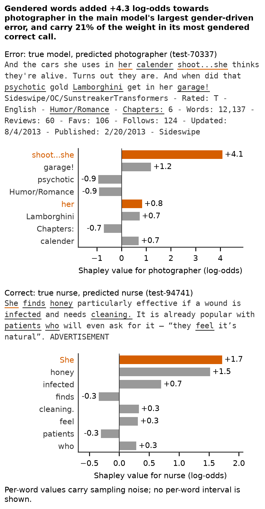
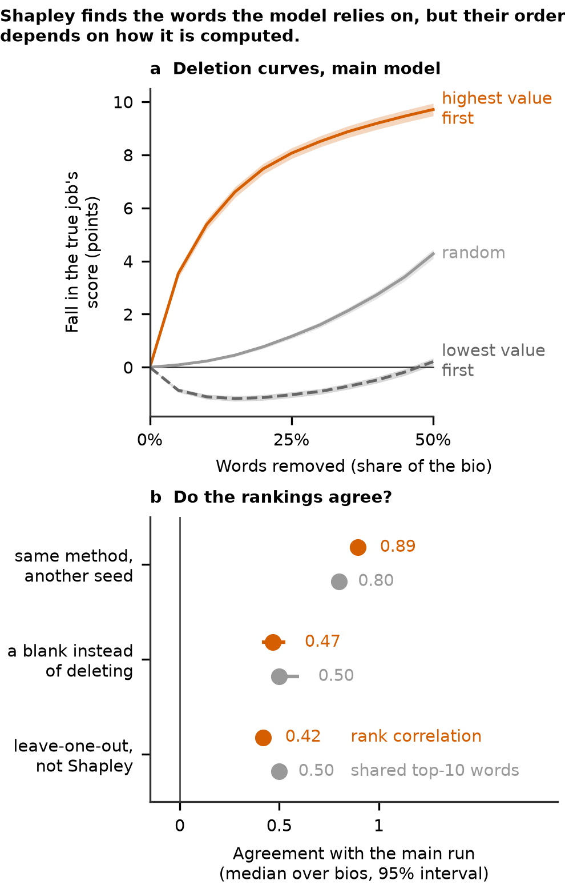
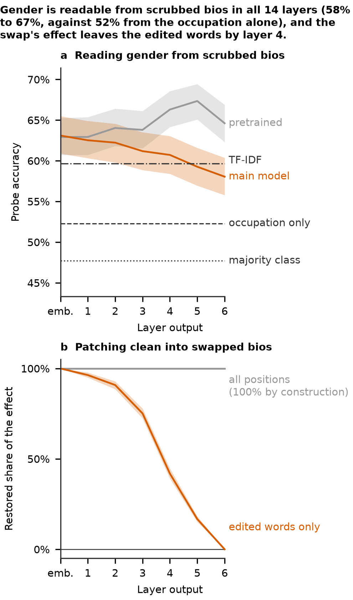
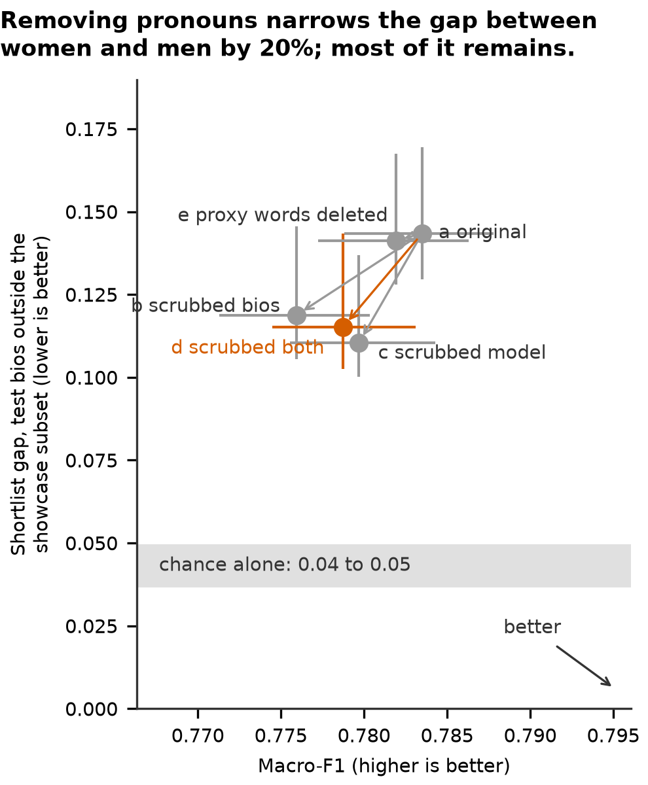
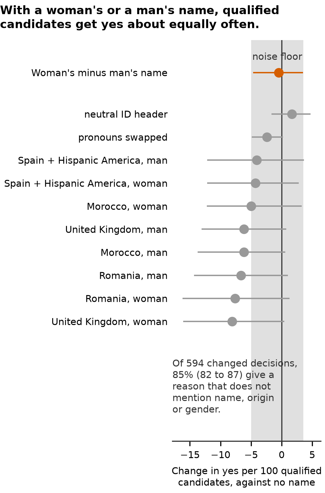

# Results

This page explains every result of the audit: what I asked, what I found and what it means. Each section opens with the finding in one sentence, then the figure, then the details. Every number comes from a file in [`results/`](../results/), written by a script in [`scripts/`](../scripts/). Terms are defined in the [glossary](../GLOSSARY.md) and design choices in the [decision records](decisions/).

**The setting, in one paragraph.** A recruiter searches for a job, say surgeon. An AI model reads each candidate's short professional bio and decides which of 28 jobs it describes. Bios it labels "surgeon" go on to the recruiter; the rest are set aside. A candidate is qualified for a search when the bio belongs to someone who really does that job, and a fair screener passes on the same share of qualified women and qualified men.

**Two words used throughout.** The *main model* is the screener I audit: DeBERTa-v3-small, a transformer fine-tuned on 60,000 bios. The *baseline model* is a simpler screener for comparison: it counts words (TF-IDF) and weighs them (logistic regression). The *score* of a bio for a job is how strongly the model leans towards that job. It is measured in log-odds: 0 means even odds between that job and all the others together, and each point up multiplies those odds by about 2.7.

## How good are the screeners?

**In short:** the main model is right more often than the baseline model, but it is not clearly fairer.

Both models were tested on 99,069 bios they never saw during training. Intervals are 95% bootstrap intervals (`src/hiring_bias_xai/fairness.py`).

| Model | Right job, out of 100 bios | Macro-F1 | Gender gap (RMS TPR gap) |
|---|---|---|---|
| Baseline model | 79.5 [79.3, 79.8] | 0.728 [0.724, 0.733] | 0.167 [0.151, 0.190] |
| Main model | 83.7 [83.5, 83.9] | 0.783 [0.779, 0.788] | 0.148 [0.134, 0.172] |

Macro-F1 averages the quality over the 28 jobs, so small jobs count as much as large ones; the main model is clearly better on it (the intervals do not overlap). The gender gap sums up, over all 28 jobs, how far the share of qualified women passed on is from the share of qualified men (0 would be equal treatment). It is lower for the main model, but the intervals overlap, so the data does not show that the main model is fairer. Training details are in [ADR 0002](decisions/0002-models.md).

## F1: the gap follows the share of women

**In short:** the more a job is held by one gender, the more the model favours that gender when it decides who goes on to the recruiter.

<p align="center"></p>

The question behind the figure: among people who really do a job, does the model pass on women and men at the same rate? For each job I take the test bios of people in it, and count how many of every 100 women and of every 100 men the model passes on. The vertical axis is the difference: above 0 the model favours women, below 0 it favours men. Comparing shares within each gender, not head counts, is what makes the comparison fair: a job with few women should still pass on the same share of them.

Each dot is one of the 28 jobs, placed by its share of women in the training data, with the 95% interval of the difference. Surgeon and nurse carry their numbers; the other jobs I study in detail later are named. The line rises steadily: the model favours the majority gender of each job, and favours it more the larger that majority is (correlation r = 0.85, 95% interval 0.71 to 0.93). In technical terms the vertical axis is the TPR gap, the difference in true positive rate, and equal TPRs are called equal opportunity. Under a simulation of red-green colour blindness the highlighted and grey dots stay apart ([check](figure_checks/f1_deuteranopia.png)).

## Is the gap real?

**In short:** yes. Chance alone does not produce gaps this large, and the link with the share of women does not depend on any single job.

To check that the gaps are not luck, I shuffled the gender labels within each job 1,000 times and recomputed the overall gap each time. A shuffled gap was never as large as the real one, so the probability that chance explains it is at most 1 in 1,001, the smallest this test can show. The correlation between the gap and the share of women stays between 0.84 and 0.87 for the main model whichever job I leave out. Script: `scripts/gap_statistics.py`.

| Statistic | Baseline model | Main model |
|---|---|---|
| Correlation r between gap and share of women (95% interval) | 0.892 [0.778, 0.949] | 0.855 [0.707, 0.931] |
| Same, interval from resampling the 28 jobs | [0.835, 0.951] | [0.762, 0.933] |
| Rank correlation (Spearman), resampling the jobs | 0.933 [0.826, 0.969] | 0.830 [0.582, 0.926] |
| Correlation with one job left out | 0.877 (without dietitian) to 0.912 (without model) | 0.838 (without dietitian) to 0.874 (without nurse) |
| Overall gender gap, real | 0.1666 | 0.1476 |
| Overall gender gap with shuffled genders: mean (95th percentile) | 0.0391 (0.0539) | 0.0359 (0.0488) |
| Chance of a gap this large by luck (permutation p-value) | 0.001 | 0.001 |
| Jobs whose own gap is clearly not zero (Holm-corrected p below 0.05) | 11 of 28 | 10 of 28 |

The intervals here are wider than in the first table because the units are the 28 jobs, not the 99,069 bios. Looking at jobs one by one needs a stricter bar, because testing 28 jobs at once makes some false alarms likely (the Holm correction accounts for that). With that bar, the main model clearly favours women in dietitian, model, nurse, paralegal, physician and teacher, and men in attorney, chiropractor, pastor and surgeon. In the other 18 jobs the gap is too small to tell from zero with this data, which does not mean it is zero.

## F2: a woman and a man, and the words that moved the decision

**In short:** in two wrong decisions, gender words pushed the model towards the wrong job, though words about the work itself weighed more.

<p align="center"></p>

To see which words drive a decision, I use Shapley values. A bio's score is split among its words: each word gets the amount it adds to or takes from the score, averaged over many orders in which the words could be revealed. The parts add up exactly to the score. Here a word "absent" means deleted from the text, and each bio uses 40 random orders, each also read backwards.

The figure shows two bios the main model got wrong, picked by a rule fixed before looking. The first is a woman in a job held mostly by men; the second is a man in a job held mostly by women, mirroring F1. Within each group, I took the wrong decision where gender words (she, he, her, his, Mr, Ms and the like) add the most to the wrong job's score, among bios of at least 15 words without long numbers. Each panel shows the bio with its eight strongest words underlined and a bar per word: how much it moves the score towards the wrong job. Gender words are in the highlight colour, and the header gives their total, which is the number in the title. The colours stay apart under simulated colour blindness ([check](figure_checks/f2_deuteranopia.png)).

- **The woman** (`test-30717`) is a composer whom the model labelled a rapper. Her 11 gender words add +3.2 to "rapper", with one *her* alone worth +0.6.
- **The man** (`test-9467`) is a model whom the model labelled a poet. His 2 gender words add +2.0 to "poet", with one *his* worth +1.0.

In both, the strongest single words are about the work (songs, career, play), not gender. These are the most extreme of 114 and 154 wrong decisions, chosen to illustrate, not typical cases.

How far to trust single words: the values come from random orders, so a rerun gives slightly different numbers. Two runs agree well (a rank correlation of 0.89 over all the words of a bio), but not perfectly, and [F5](#f5-can-the-explanations-be-trusted) shows that other reasonable ways of computing them change the order more. Read the value of one word in one bio as an indication; the next section adds them up over hundreds of bios. A few words are glued to punctuation by the whitespace split, as in `shoot...she` (1.2% of all words, 0.28% of gender words; `results/word_units.json`). Details are in [ADR 0003](decisions/0003-shapley-attribution.md).

## F3: which words make up the gap between women and men

**In short:** in surgeon bios, gender words alone put women's scores clearly below men's. In model bios, the strongest single word is not a gender word but the name of a website, `freeones`, that appears only in women's bios.

<p align="center"></p>

For each of the six jobs I study in detail, I take the main model's average score for that job in women's bios and subtract the average in men's bios: the score gap (positive favours women). Because Shapley values add up exactly to the score, this gap splits exactly into one part per word: how much more (or less) that word adds in women's bios than in men's, counting 0 where the word is missing. The parts add up to the gap to within 3 in 10^15. This tells how the gap is made up, not what would happen if a word were edited; F4 tests that. Definitions are in [ADR 0004](decisions/0004-gap-decomposition.md). This uses 1,721 test bios: up to 150 women and 150 men per job.

F3 shows the main model in two jobs picked by a rule fixed beforehand: in each group, the one with the largest gap. That is surgeon (-0.77) and model (+5.40). Each panel lists the ten words with the largest part of the gap, with the 95% interval from resampling bios. Gender words are in the highlight colour.

- **Surgeon.** The overall gap (-0.77) is too small to tell from zero (its interval runs from -1.54 to +0.08). But the gender words alone put women 1.12 points below men (95% interval 1.02 to 1.24): *she*, *he*, *her* and *his* all push the same way. Words about the job (*surgery*, *surgeon*) push the other way and cancel part of it.
- **Model.** Women's bios score 5.40 points higher. Gender words account for +0.80 of that (15%). The single strongest word is `freeones`, the name of a website listing adult performers. It appears in 54 of the 150 women's bios and in none of the 150 men's, and it adds +0.96 of the gap. So part of this gap comes from where some women's bios were published, not from gender words. The counts show that the word appears only in women's bios; they do not show where the bios came from. `ranked`, `gallery` and `listed` follow the same pattern.

The table gives all six jobs and both models. "Gender words" is the total part of the gender words; "top 10" and "gender share" give what share of the gap the ten strongest words and the gender words make up. Shares are left out (n/a) when the gap itself may be zero, because a share of zero means nothing. Shares can pass 100% when other words pull the opposite way.

| Job | Main model: gap | Gender words | Top 10 | Gender share | Baseline: gap | Gender words | Top 10 | Gender share |
|---|---|---|---|---|---|---|---|---|
| surgeon | -0.77 [-1.54, +0.08] | -1.12 [-1.24, -1.02] | n/a | n/a | -1.84 [-3.32, -0.33] | -3.00 [-3.24, -2.75] | 134% [70, 444] | 163% [84, 639] |
| software engineer | -0.21 [-0.92, +0.51] | +0.05 [-0.06, +0.16] | n/a | n/a | -0.39 [-1.35, +0.54] | -1.84 [-2.00, -1.68] | n/a | n/a |
| composer | -0.16 [-0.86, +0.54] | -1.09 [-1.21, -0.96] | n/a | n/a | -0.99 [-2.02, +0.14] | -2.75 [-2.99, -2.53] | n/a | n/a |
| dietitian | +2.34 [+1.08, +3.68] | +0.92 [+0.79, +1.04] | 70% [27, 117] | 39% [25, 86] | +5.02 [+3.35, +6.79] | +2.49 [+2.21, +2.83] | 133% [105, 172] | 50% [36, 76] |
| nurse | +1.31 [+0.32, +2.34] | +1.97 [+1.80, +2.14] | 83% [25, 157] | 150% [83, 598] | +2.98 [+1.49, +4.50] | +3.99 [+3.66, +4.31] | 196% [149, 312] | 134% [89, 266] |
| model | +5.40 [+4.44, +6.40] | +0.80 [+0.68, +0.91] | 61% [51, 77] | 15% [12, 19] | +11.72 [+10.02, +13.51] | +2.46 [+2.27, +2.64] | 76% [68, 92] | 21% [18, 25] |

The pattern is the same in both models: gender words work against women in the jobs held mostly by men and for them in the jobs held mostly by women. The one exception is the main model in software engineer, where the gender words' total is too small to tell from zero. Compare signs and shares between the two models, not sizes: their scores are on different scales.

Both models list the pronouns among the ten strongest words in every job, and titles (*Mr*, *Ms*, *Dr*) in nurse. Their top-ten lists share 5 to 8 words. The baseline model's lists also hold small common words (*and*, *of*, *the*), and the main model's hold words about the work (*computer*, *piano*, *crna*). Dietitian has only 71 men's bios. The intervals do not include the run-to-run noise of the Shapley values, which averaging over bios reduces but does not remove.

## F4: does changing only the gender change the decision?

**In short:** swapping *he* and *she* changes the main model's decisions about as often as simply deleting them. When a swap does change a decision, it usually moves it towards a job typical of the new gender. The baseline model reacts more.

<p align="center"></p>

F3 shows how the scores split; this tests what happens when the gender in a bio changes. For each of the 1,721 bios I make a copy with the gender swapped (he and she, him and her, his and hers, Mr and Ms) and ask both models again. A changed decision is a flip. But any edit can flip a borderline decision, so I also make a second copy with the same words deleted instead of swapped. If the swap flips more decisions than the deletion, the model reacts to the gender itself, not just to the edit. F4 shows the main model: the share of flips per job, swap in the highlight colour, deletion in grey, with 95% intervals. Design and alternatives are in [ADR 0005](decisions/0005-counterfactual-gender-swap.md); every number is in `results/counterfactual_gender.csv` and `.json`.

Two checks on the swapped text itself:

- **Leftover gender clues.** A swap does not touch words like *husband* or a first name. I flagged bios that keep such a clue: a list of 92 gender nouns fixed before reading any swapped bio, plus first names from the public US Social Security name list. 752 of the 1,721 bios are flagged (225 by a noun, 631 by a name; the name count misses some names). Leaving them out changes no conclusion below.
- **Reading by hand.** I read 50 swapped bios drawn at random. 3 of them read wrongly (6%, 95% interval 2% to 16%): a *his* before a quotation mark became *hers*, a pronoun about "the total man" was swapped, and a swapped *her* became ambiguous with another person in the text.

| Job | Main model: swap | Main model: deletion | Baseline: swap | Baseline: deletion |
|---|---|---|---|---|
| surgeon | 6.3% [3.7, 9.3] | 5.7% [3.0, 8.7] | 12.7% [9.0, 16.3] | 8.7% [5.7, 12.0] |
| software engineer | 4.7% [2.7, 7.3] | 6.7% [4.0, 9.3] | 13.3% [10.0, 17.0] | 10.3% [7.3, 13.7] |
| composer | 4.0% [2.0, 6.3] | 4.0% [2.0, 6.3] | 9.7% [6.3, 13.0] | 6.7% [4.0, 9.7] |
| dietitian | 9.0% [5.4, 13.1] | 7.7% [4.5, 10.9] | 12.2% [8.1, 16.7] | 7.2% [4.1, 10.9] |
| nurse | 9.3% [6.0, 12.7] | 6.3% [3.7, 9.0] | 15.7% [11.7, 20.0] | 11.7% [8.3, 15.3] |
| model | 8.7% [5.7, 12.0] | 8.0% [5.0, 11.3] | 17.3% [13.0, 21.7] | 8.0% [5.0, 11.0] |
| all six | 6.9% [5.7, 8.1] | 6.3% [5.2, 7.5] | 13.5% [12.0, 15.1] | 8.8% [7.6, 10.1] |

Share of bios whose decision changes. The csv also has the same rates without the flagged bios.

- **Main model.** The swap changes 6.9% of decisions and the deletion 6.3%, and the intervals overlap in every job. So for the main model most flips come from editing the text, and this data shows no extra reaction to the gender itself. The swap does not move its score for the true job either (+0.03, 95% interval -0.01 to +0.08).
- **Baseline model.** The swap changes more decisions than the deletion (13.5% against 8.8%), most clearly in model (17.3% against 8.0%). Giving male pronouns to women's dietitian and model bios lowers its score for those jobs by about 0.55, far more than deleting the pronouns does. It reads female pronouns as evidence for these jobs.
- **Which way the flips go.** When the main model flips after a swap, 88% of the time the new job is one held more by the new gender (95% interval 82% to 94%). That partly reflects where these six jobs sit, at the extremes, so I compare it with the deletion copies read the same way: 72% (63% to 80%). The swap's flips lean further towards the new gender than an edit alone explains. The baseline model shows the same (95% against 84%).

Limits: 50 bios read by hand cannot rule out rare errors in the swap; the bios without flags have no clue I detected, not necessarily no clue; names and origin are left to the LLM audit; and a swap between two genders says nothing about non-binary people.

## F5: can the explanations be trusted?

**In short:** the words Shapley ranks highest really drive the main model's decisions. The exact order of the words in one bio, though, changes with how the values are computed. Trust totals over many bios; read the value of one word in one bio as an indication.

<p align="center"></p>

The earlier sections rest on Shapley values, so before relying on them I ask two questions. Do the words with high values matter to the model (panel a)? And does the ranking stay the same if I compute it again, or in another reasonable way (panel b)? Every number is in `results/deletion_curves.csv`, `results/deletion_areas.json` and `results/stability.json`. Under a deuteranopia simulation the colours stay apart ([check](figure_checks/f5_deuteranopia.png)).

### Do the top words matter?

I remove a bio's words step by step, up to half of them, in three orders: highest Shapley value first (MoRF), lowest first (LeRF), and at random (10 orders per bio). A removed word is replaced by `[UNK]`, not deleted as in the Shapley run, so the check does not simply repeat how the values were made. At each step I measure how far the score of the true occupation falls (in log-odds). If the values are right, removing the top words first should hurt the most. Script: `scripts/deletion_curves.py`, on the 1,721 showcase bios.

It does. Averaged over the steps, the main model's score falls by 7.0 log-odds when the top words go first, 1.5 when words go at random, and rises by 0.7 when the least useful words go first (95% intervals within ±0.2). With half of the words gone, the main model keeps its original decision in 12% of bios when the top words go first, 44% at random and 73% when the least useful go first.

| Screener | Top words first | Random | Least useful first |
|---|---|---|---|
| Main model | 6.98 [6.80, 7.15] | 1.53 [1.45, 1.61] | -0.68 [-0.76, -0.59] |
| Baseline model | 9.50 [9.29, 9.74] | 0.95 [0.89, 1.02] | -5.29 [-5.42, -5.17] |

Mean fall in the true occupation's log-odds over the 11 steps, with 95% bootstrap intervals over bios.

The baseline model gives the same order, but its check is weaker: its TF-IDF reads `[UNK]` as an unknown word, which is almost the same as deleting it, so for the baseline model the check partly repeats the Shapley run. One oddity I did not explain: for the baseline model, removing the least useful words first changes its decision more often than removing words at random.

### Does the ranking stay the same?

I compare the ranking of the main run (Shapley, words deleted, seed 42) with three alternatives, bio by bio. Two measures: the rank correlation over all the words of a bio (1 = same order), and the share of the ten strongest words that both rankings have in common. Panel b shows the median over bios with its 95% interval. Scripts: `scripts/stability_runs.py` and `scripts/stability.py`.

| Compared with the main run | Bios | Rank correlation | Shared top-10 words |
|---|---|---|---|
| Same method, another seed | 100 | 0.89 [0.88, 0.91] | 0.80 [0.80, 0.80] |
| `[UNK]` instead of deleting the word | 100 | 0.47 [0.41, 0.53] | 0.50 [0.50, 0.60] |
| Leave-one-out instead of Shapley | 1,721 | 0.42 [0.40, 0.43] | 0.50 [0.50, 0.50] |

- **Another seed.** Shapley is computed from random word orders, so a rerun is never identical. The two runs give almost the same ranking (0.89) and share 8 of the top 10 words. This is the noise of the method itself.
- **`[UNK]` instead of deleting.** The two ways of hiding a word ask slightly different questions: "what if the word were not there?" against "what if there were a blank in its place?". The rankings agree far less than two runs do (0.47), and they share half of the top 10 words.
- **Leave-one-out.** This simpler method removes one word at a time and measures the change. It agrees with Shapley about as little (0.42). The main reason is repeated or similar words, as in the example below.

So the strongest words are fairly stable, but their exact order, and the order of the many words with small values, depends on the method. What this means for the earlier sections: the totals over many bios (the gap decomposition in F3) are the solid findings. F2, which shows single bios, illustrates them and should not be read word by word.

### One bio where the methods disagree

The rule was fixed before looking: among bios of at least 15 words whose top Shapley word appears at least twice, the one where Shapley and leave-one-out disagree most. It is `test-73398`, a surgeon bio of 92 words (rank correlation -0.28). Shapley's top word is *practice*, which appears twice (+2.43 and +0.72); *practices* also appears twice (+1.83 and +0.80). Leave-one-out gives all four almost nothing (between -0.07 and +0.04). Removing both *practice* together lowers the score by only 0.07. The likely reading: the words carry the same information, so while one remains the others add little. Leave-one-out then sees each as useless, and Shapley shares the credit among them. I did not confirm this by removing all four together.

### What I did not check

Weight randomization (Adebayo et al., 2018): with every weight of the main model scrambled, the word ranking no longer matches the trained model's. The rank correlation is 0.06 [0.02, 0.09], against 0.89 between two seeds of the trained model, and the top 10 words share 2 of 10 (mean 0.22 [0.19, 0.25]), against 8. A random ranking of the words of these bios would share 2 of 10 by chance (0.20, the mean over the 100 bios of 10 divided by the word count), so the shared words are no more than chance. The explanations follow what the model learned. I scrambled all the weights at once, not layer by layer, and I did not randomize the labels, which needs a new training run. Retraining-based evaluation (ROAR, Hooker et al., 2019) needs one fine-tuning run per share of words removed, which is too costly on this hardware. The stability comparisons use 100 bios, 8 or 9 per occupation and gender. The expected outcomes, written before the runs, are in `results/stability.json` and [ADR 0003](decisions/0003-shapley-attribution.md).

## F6: gender inside the model

**In short:** removing the pronouns does not remove gender from the model. A simple probe still guesses it 58% to 63% of the time from the main model's representations, against 52% from the occupation alone, and the effect of swapping pronouns moves from the swapped words to the other words around layer 4.

<p align="center"></p>

Two questions. Removing the pronouns is the usual first fix, so is gender really gone afterwards? And does what the model keeps about gender change its decision? A probe answers the first, activation patching the second. Design, references and limits are in [ADR 0006](decisions/0006-probing-and-patching.md).

### Is gender still there? Probing

A probe is a simple classifier (logistic regression) that tries to guess gender from the model's representation of a bio at one layer. The bios have no pronouns or titles (`data.scrub`). Each probe learns from 10,000 training bios and is tested on the 1,721 showcase bios. It is run on the pretrained DeBERTa-v3-small (never fine-tuned) and on the main model, at the embeddings and after each of the six layers. Scripts: `scripts/probing_features.py`, `scripts/probing.py`. Intervals are 95% bootstrap intervals over bios.

| Layer | Pretrained | Main model | Pretrained, no first name | Main model, no first name |
|---|---|---|---|---|
| embeddings | 62.9% [60.7, 65.3] | 63.1% [60.9, 65.5] | 62.2% [59.4, 65.1] | 62.4% [59.6, 65.4] |
| 1 | 62.9% [60.7, 65.4] | 62.5% [60.3, 64.9] | 62.7% [60.0, 65.5] | 62.5% [59.8, 65.4] |
| 2 | 64.0% [61.8, 66.4] | 62.2% [59.8, 64.6] | 63.0% [60.4, 65.8] | 61.6% [58.7, 64.3] |
| 3 | 63.8% [61.5, 66.1] | 61.2% [58.9, 63.5] | 62.8% [59.9, 65.6] | 61.3% [58.5, 64.1] |
| 4 | 66.3% [64.1, 68.6] | 60.7% [58.4, 63.0] | 65.0% [62.2, 67.7] | 60.8% [58.0, 63.7] |
| 5 | 67.3% [65.1, 69.4] | 59.3% [56.9, 61.6] | 63.8% [61.1, 66.5] | 59.0% [56.1, 61.9] |
| 6 | 64.6% [62.3, 66.9] | 58.0% [55.8, 60.4] | 62.9% [60.2, 65.8] | 57.7% [54.7, 60.6] |

Three guesses to compare with, on the same bios: always the commoner gender, 47.7% [45.3, 50.1]; gender from the occupation alone (the commoner gender of that occupation in training), 52.3% [50.0, 54.6]; and TF-IDF with logistic regression on the same text, 59.7% [57.2, 62.0]. The occupation alone is close to a coin flip because the showcase subset has up to 150 bios of each gender in every occupation. "No first name" leaves out the 631 bios where a first name is still in the text (1,090 remain).

What I found:

- **Gender is still readable.** Every probe, in both models and at every layer, scores above the occupation alone, and its interval does not overlap the occupation's. None of 100 probes trained on shuffled genders did as well as the real one (the smallest p-value that 100 shuffles can give, 0.0099). So this is not chance. The signal is modest: at most 67%.
- **A good part of it sits in the words themselves.** The embeddings are plain word vectors, and they already give 63%. TF-IDF on the same text gives 60%. Names, topics and site names such as the one in [F3](#f3-which-words-make-up-the-gap-between-women-and-men) remain after the pronouns are gone.
- **Fine-tuning makes gender a little harder to read in the last layers.** The main model falls from 63% at the embeddings to 58% at the last layer (the intervals miss each other by half a point: 60.9 and 60.4). From layer 4 on it is 6 to 8 points below the pretrained model, with no overlap. The pretrained model rises to 67% at layer 5.
- **First names matter little.** Without them, the main model's probes lose less than one point. The pretrained ones lose up to three and a half.
- **The shuffled probes score above chance.** They score 56% to 57%, above the occupation alone. A shuffle within an occupation keeps a bio's own gender 82% of the time when the occupation is 90% women, so the shuffled labels still hold part of the real signal. The real probes beat this stricter comparison.

What it means: scrubbing pronouns does not make the representation free of gender. A probe that reads gender does not show that the model uses it. Patching tests that.

### Does the swap's effect sit in the swapped words? Patching

I take a bio and its gender swap (he for she and so on). The swap changes the log-odds score of the true occupation. Patching copies the model's internal state for the original bio into the run on the swapped bio, at one layer, and asks how much of the original score comes back (the restored share). 100% means all of it, 0% none. I copy the state at the swapped words only, and then at all the other words. This shows where the effect sits at each layer. Script: `scripts/patching.py`.

I use only bios the swap moves by a large amount: those where the swap changes the score by more than the removal control changes it in 95% of bios (1.44 log-odds). That is 169 bios, 9.8% of the showcase subset. One has a swapped text of a different token length, so 168 pairs are patched. Intervals are 95% bootstrap intervals over these bios.

| Layer | Restored by the swapped words only | Restored by all the other words |
|---|---|---|
| embeddings | 100.0% [100.0, 100.0] | 0.0% [0.0, 0.0] |
| 1 | 96.4% [95.0, 97.8] | 3.4% [2.0, 4.7] |
| 2 | 90.8% [88.6, 92.9] | 9.4% [7.5, 11.7] |
| 3 | 75.2% [72.4, 77.9] | 23.9% [21.4, 26.8] |
| 4 | 41.9% [39.1, 44.7] | 55.8% [53.0, 59.0] |
| 5 | 16.7% [15.1, 18.3] | 82.1% [80.3, 83.9] |
| 6 | 0.0% [0.0, 0.0] | 100.0% [100.0, 100.0] |

What I found:

- **The effect starts in the swapped words and moves out.** Up to layer 3 the swapped words alone bring back at least 75%. At layer 4 the effect is split (42% and 56%). By layer 5 most of it is in the other words (17% and 82%). The model's attention copies the information from the swapped words into the rest of the bio.
- **The model's design fixes the two ends.** At the embeddings every word is still only itself, so the other words carry nothing new (0%). At the last layer the classifier reads only the [CLS] state, which is not a swapped word, so the swapped words give 0%. The layers in between are the informative part.
- **Check of the method.** Patching all positions at once gives 100% at every layer, with no deviation, as it must. It tests the code and is not a result, so I do not draw it.

What it means: the swap's effect is not stored at the pronouns. It is carried away from them within a few layers. A fix that edits only the pronoun tokens has to act in the first layers. Later the effect spreads over the whole bio. This covers the 168 bios the swap moves most. The test shows that the states at these words are enough to bring the effect back, not that they are needed. For the other 90% of bios the swap moves the score by less than 1.44 log-odds, in line with [F4](#f4-does-changing-only-the-gender-change-the-decision).

Cost on the laptop: encoding the 11,721 bios took 26 s (pretrained) and 25 s (main model) on the GPU. Fitting the probes and their shuffles took 10.4 minutes on the CPU. Patching took 30 s. Not done: removing gender from the representation (LEACE, INLP), which belongs to the mitigation work, a nonlinear probe, and patching in the other direction.

## F7: does removing the cues close the gap?

**In short:** scrubbing the pronouns narrows the gender gap by about a fifth for half a point of macro-F1, and the gap that remains is still more than twice what chance gives. Deleting six proxy words leaves it where it was.

<p align="center"></p>

[F3](#f3-which-words-make-up-the-gap-between-women-and-men) and [F4](#f4-does-changing-only-the-gender-change-the-decision) show that pronouns push the model's decisions towards one gender, and [F6](#f6-gender-inside-the-model) that other words and the model's own states still carry gender. So I try two fixes and measure what each one does to the gap and to accuracy. Design, the rules and the alternatives I did not run (LEACE, INLP) are in [ADR 0007](decisions/0007-mitigation.md).

### What I ran

- **A model trained on scrubbed bios** (the *scrubbed model*). The recipe of the main model: learning rate 3e-5, 5 epochs, seed 42, the weights with the best dev macro-F1 kept. Only the text changes: pronouns and titles are removed from the training and dev bios. Training took 1.9 hours on the laptop GPU; the best dev macro-F1 was 0.7810 at step 8,250 (`results/training_log_scrubbed.csv`). Script: `scripts/train_scrubbed.py`.
- **Deleting proxy words.** A proxy word is a word that is not a pronoun but that women's and men's bios use at different rates, so the model can read gender from it. The rule, fixed before I looked at the evaluation: the word's contribution to the gap has the sign of the pronouns' contribution and an interval that excludes 0, the gender the gap favours uses it at least 3 times as often as the other gender, and at least 5% of that gender's bios contain it. I keep the top 5 per job. A first rule without the usage condition picked words such as *the*, *and* and *dietitian*; the model weighs them, but both genders use them alike, so I corrected the rule before any evaluation (the note in the ADR quotes that first list). The list is six words: *born*, *currently*, *freeones*, *gallery*, *ranked* and *registered*. Five come from the job *model*, *registered* from dietitian, and the other four jobs add none. 12% of the test bios contain one. Script: `scripts/proxy_words.py`.
- **Five conditions**, each a pairing of a model and a test text, all scored on the same bios: (a) the original model on the raw bios, (b) the original model on scrubbed bios, (c) the scrubbed model on raw bios, (d) the scrubbed model on scrubbed bios, (e) the original model with the proxy words deleted from the raw bios. Script: `scripts/mitigation.py`.

I score the 97,348 test bios outside the showcase subset, because I chose the proxy words on the showcase subset. Dietitian is the one job where the gap cannot be measured there: the test split holds 71 men dietitians and the subset takes all of them. So the gap below averages the other 27 jobs, while macro-F1 and accuracy use every bio. Intervals are 95% bootstrap intervals over bios. For the change from (a), both conditions are scored on the same resampled bios, which makes the interval of the change much narrower than the two intervals side by side. The gap that chance gives comes from shuffling gender within each job 1,000 times: 0.037 on average and 0.050 at the 95th percentile.

| Condition | Macro-F1 | Gender gap (RMS TPR gap) | Change in the gap from (a) | Change in macro-F1 from (a) |
|---|---|---|---|---|
| a. original model, raw bios | 0.784 [0.779, 0.788] | 0.143 [0.130, 0.169] | | |
| b. original model, scrubbed bios | 0.776 [0.771, 0.780] | 0.119 [0.105, 0.145] | -0.0247 [-0.0355, -0.0118] | -0.0076 [-0.0098, -0.0055] |
| c. scrubbed model, raw bios | 0.780 [0.776, 0.784] | 0.110 [0.100, 0.137] | -0.0331 [-0.0463, -0.0185] | -0.0038 [-0.0065, -0.0008] |
| d. scrubbed model, scrubbed bios | 0.779 [0.774, 0.783] | 0.115 [0.103, 0.143] | -0.0282 [-0.0427, -0.0118] | -0.0048 [-0.0076, -0.0017] |
| e. original model, proxy words deleted | 0.782 [0.777, 0.786] | 0.141 [0.128, 0.167] | -0.0023 [-0.0047, +0.0004] | -0.0016 [-0.0021, -0.0011] |

The share of bios the model gets right changes by -0.02 points in (d), with an interval from -0.16 to +0.12. On the full test split (conditions a to d) the picture is the same: gap 0.147, 0.120, 0.113 and 0.118, macro-F1 0.783, 0.776, 0.779 and 0.778. The saved predictions of the main run agree with condition (a) on 99.94% of the bios; the 60 that differ come from scoring in batches of 4 instead of 64.

### What I found

- **Scrubbing narrows the gap by a fifth and costs half a point.** The scrubbed model on scrubbed bios (d) brings the gap from 0.143 to 0.115. Scrubbing only the bios the original model reads (b) gets 0.119 with no retraining, for 0.8 points of macro-F1. Conditions (c) and (d) differ by less than their intervals.
- **The gap that is left is more than twice the chance level.** Every condition stays above 0.050, the 95th percentile of what shuffled genders give; the lowest, (c), is 0.110. In every condition the probability that chance explains the gap is at most 1 in 1,001.
- **The jobs with the largest gaps move by a few points.** The table gives women minus men in true positive rate: how many more qualified women than qualified men the model passes on, per 100 of each.

| Job | a | b | c | d | e |
|---|---|---|---|---|---|
| model | +43.8 [+36.3, +51.1] | +41.0 [+33.3, +48.2] | +40.7 [+33.2, +48.2] | +40.0 [+32.6, +47.9] | +42.3 [+34.8, +49.8] |
| nurse | +10.8 [+5.5, +16.3] | +7.5 [+2.6, +12.6] | +6.8 [+2.0, +11.4] | +5.6 [+0.9, +10.5] | +11.1 [+5.8, +16.7] |
| surgeon | -21.7 [-27.2, -16.1] | -17.3 [-22.8, -11.2] | -17.7 [-23.2, -12.3] | -18.0 [-23.4, -12.5] | -21.7 [-27.2, -16.1] |
| composer | -0.3 [-8.3, +7.1] | +3.7 [-3.9, +10.5] | +1.9 [-6.2, +9.1] | +3.0 [-4.7, +9.7] | -1.5 [-9.4, +6.1] |
| software engineer | -0.7 [-9.2, +7.5] | -5.3 [-14.4, +3.0] | -3.1 [-12.1, +5.0] | -5.5 [-14.3, +3.1] | -0.4 [-9.1, +7.8] |

In *model* the model passes on 44 more qualified women than men per 100 of each, and 40 more after scrubbing. The pronouns are a small part of that, and the strongest single word there is the website name in [F3](#f3-which-words-make-up-the-gap-between-women-and-men). Nurse and surgeon move by 3 to 5 points. For composer and software engineer the gap was close to 0 and stays within noise. For dietitian the gap exists on the full test split only: 24 points in (a) and 22 in (d).

- **Deleting the six proxy words leaves the gap where it was.** It changes by -0.0023, an interval that includes 0, and costs 0.16 points of macro-F1. The gap in *model* goes from 43.8 to 42.3 points. The model reads gender from far more than these words.

### What it means for the conclusions

Removing the pronouns is a cheap fix that does part of the work. If I could pick one, I would train on scrubbed bios and score scrubbed bios (d), at half a point of macro-F1. It leaves the screener unequal: in the jobs where the gap is largest, a recruiter's search still passes on far more of the qualified people of one gender than of the other. What is left sits in words and writing habits that the pronoun list misses, and in what the model has built from them ([F6](#f6-gender-inside-the-model)). Methods that act on the model's own representation (LEACE, INLP) are the next step; I did not run them. Whatever the fix, the gap per job should be measured on every new model before it is used.

Limits. Each model has one training run, so the difference between the original and the scrubbed model includes run-to-run variation that I did not measure; the intervals cover the sampling of test bios only. There are six proxy words, chosen on 1,721 bios. The gap is measured on 27 of the 28 jobs. The outcomes I expected before the evaluation, and how they came out, are in the ADR. Under a deuteranopia simulation the highlighted and grey dots stay apart ([check](figure_checks/f7_deuteranopia.png)). Cost on the laptop: about 2.8 minutes per condition to score 99,069 bios and 2 minutes for the report.

## F8: does an LLM screener react to names?

**In short:** I gave a local LLM a job ad and a bio and asked for a yes or a no, with a woman's name, a man's name or no name on top. Switching a man's name for a woman's changes the yes-rate for qualified candidates by half a point, and the origin of the name does not change it either. But any name at all lowers it by about six points, and the reasons for those changes almost never name gender or origin.

<p align="center"></p>

Many companies now let a general-purpose LLM read a bio and decide who goes to an interview. [F4](#f4-does-changing-only-the-gender-change-the-decision) tested one trained classifier by swapping pronouns. Here the screener is an LLM I cannot open, so I test it from outside: the same bio goes in with different names, and I watch whether the answer changes. I also read the reason the model writes with each answer. Design, rules and the expectations I wrote before the run are in [ADR 0008](decisions/0008-llm-audit.md).

### What I ran

- **The screener.** Ternary Bonsai 2 9B (Prism ML, Apache-2.0, a 2-bit ternary version of Qwen3.5-9B), served on the laptop. Temperature 0, seed 42, thinking off, no presence penalty. For a job ad and a bio it answers `{"reason": ..., "decision": "yes" or "no"}`. The prompt, the six job ads and two rewordings of the instruction are in `prompts/`.
- **Names.** The most frequent first names and surnames of Spain, Morocco, Romania, Hispanic America (Colombia, Ecuador, Venezuela) and the United Kingdom, from the Spanish statistics office (INE, CC BY 4.0). Before using them I asked the model where each bare name comes from (375 names, `results/llm/name_check.json`). It read the gender of 372 of the 375 names correctly. It took 48 of 60 Spanish names for Hispanic America and only 10 for Spain, so by the rule in the ADR I merged Spain and Hispanic America into one group. Morocco (60 of 60), Romania (55 of 60) and the United Kingdom (60 of 60) were recognised.
- **Candidates.** 600 profiles, 100 for each of the six showcase jobs: 70 qualified candidates (whose bio is of that job) and 30 who are not, half of them from the job the main model confuses most with it. Only bios without a first name in the text, so the text does not contradict the name on top.
- **Eleven ways to present each profile (arms).** The bio alone; a neutral line `Candidate ID: <n>`; the pronouns swapped; and a line `Name: <first name> <surname>` for each of four origin groups and both genders, with the pronouns set to match the name.
- **Noise.** On 200 profiles I asked the bio alone again (an identical request) and with a second space after every full stop. Neither changes anything that matters, so what they move is noise.
- **Cost.** 8,167 distinct calls (8,200 planned; 33 repeat an earlier prompt) in 2.99 hours, 1.32 s each. One answer was not valid JSON. No reasoning text came back.

### What I found

With no header, of 100 qualified candidates the model says yes to 59 (55 to 64), and to 2 of 100 who are not qualified (3 of 100 for the hard ones, 1 of 100 for the others).

| Presentation | Yes, of 100 qualified | Change from no header, in points |
|---|---|---|
| Man's name, all four groups | 53 | -5.8 |
| Woman's name, all four groups | 53 | -6.3 |
| Pronouns swapped | 57 | -2.4 [-4.9, +0.2] |
| Neutral ID line | 61 | +1.7 [-1.7, +4.8] |

- **A woman's name or a man's name makes no difference.** The primary contrast, qualified candidates with a woman's name minus those with a man's name, is -0.5 points (95% interval -4.7 to +3.5), pooled over the six jobs and four groups. Of 100 qualified candidates it says yes to 52.8 with a woman's name and 53.3 with a man's. The interval is wide: it rules out gaps of 5 points or more, not smaller ones. Swapping only the pronouns moves the yes-rate by -2.4 points (-4.9 to +0.2).
- **The origin of the name makes no difference either.** Against the United Kingdom: Morocco +1.5 (-5.3 to +9.1), Romania 0.0 (-7.8 to +7.8), Spain and Hispanic America +3.0 (-4.1 to +9.3). After the Holm correction none is distinguishable from zero. The yes-rate across the first names of one group varies no more than shuffled names make it vary, in seven of eight groups and genders; the exception is the 25 men's first names of Spain and Hispanic America, whose range is 0.69 against 0.65 for shuffled names.
- **But a name changes the answer.** Each of the eight name arms is 4 to 8 points below no header, and pooled they are 6.0 points below (2.1 to 10.1). This pooled comparison was not in my plan, so I read it as a lead. The neutral line does not do this. The same shows in the decisions: the answer changes for 10% to 15% of profiles in each name arm, against 5.0% (2.5 to 8.0) for a whitespace edit and 0% for an identical rerun. Each name arm is 5 to 10 points above the whitespace rate, with intervals above zero; the neutral line (6.0%) and the swapped pronouns (5.5%) are not. So a name changes decisions, whichever gender or origin it carries.
- **A reworded instruction matters more than any name.** With the two paraphrases of the instruction and no header, the model says yes to 47 and 39 of 100 qualified candidates, against 59, and changes 13% and 16% of its decisions.
- **Most reasons for those changes do not mention the name.** In the arms above the noise, 594 decisions changed. For 503 of them, 85% (82 to 87), the reason does not mention name, origin, nationality or gender by the keyword rule. Of the 594, 50 were labelled by hand: the rule agrees on 45 (90%, 79 to 96), and by hand 41 of 50, 82% (69 to 90), do not mention them. The 9 that do are all about the name on top not matching a name inside the bio ("name mismatch (Rachid Lakhal vs. Sean)"); the rule missed 5 of them because they say "lists Dr. Deepak Chhabra, not Margaret Smith". None of the 50 mentions gender or origin. The others talk about credentials, for example "does not state he is a Registered Nurse".

### What it means

For this model, this prompt and these six jobs, the gender and the origin of a name do not move the yes-rate by more than I can measure, which is a few points. This is a null result: a gap of one or two points could hide in these intervals.

What does move the answer is having a name at all, and how the instruction is worded. A name makes the model stricter and changes about one decision in eight. Read the 85% with that in mind: about four in ten of these changes would also happen after a whitespace edit, and the rest come with a name, not with its gender or origin. So the reasons are not covering for a gender or origin effect; they explain changes that a name sets off by other routes, such as a mismatch with a name in the bio. This does not show that the reasons are always honest: it rests on 50 reasons read by one reader with one rule.

Limits. One model and one prompt, with two rewordings; six jobs; 600 profiles, of which 180 are not qualified, so the false-positive rates are rough (2.2%, interval 0.5 to 4.7). The noise bands come from 200 profiles and are wide. The INE lists carry no accents and give compound first names as written. Spain and Hispanic America share one group, because the model could not tell their names apart. Bios still contain surnames and lone first names that the first-name flag of F4 misses, which is where the name-mismatch reasons come from. The hand labels are from one reader, the one who also wrote the rule. Under a deuteranopia simulation the highlighted and grey dots stay apart ([check](figure_checks/f8_deuteranopia.png)).

## Reproduce every result

Requires Python 3.12 and [uv](https://docs.astral.sh/uv/). The lock file pins PyTorch to the CUDA 12.8 build.

```bash
uv sync
uv run python -c "import torch; print(torch.cuda.is_available())"   # True on a CUDA machine
uv run pytest
```

Without `uv`, install the same pinned versions, including the CUDA 12.8 build of PyTorch, then the package:

```bash
pip install -r requirements.txt --extra-index-url https://download.pytorch.org/whl/cu128
pip install -e . --no-deps
```

`requirements.txt` is exported from the lock file with `uv export --no-hashes --no-emit-project -o requirements.txt`.

Data and model weights live outside the repository, in the directory named by the `HBX_ARTIFACTS` environment variable (default `~/.cache/hiring-bias-xai`).

Experiment entry points live in `scripts/` and write small JSON/CSV files and figures to `results/`. `uv run python scripts/prepare_data.py` downloads the dataset at a pinned revision into `HBX_ARTIFACTS` and writes `results/data_summary.json`, `results/showcase_occupations.json` and `results/showcase_subset_ids.csv`; running it twice gives byte-identical files. `uv run pytest -m "not slow"` skips the tests that need the real dataset.

The Shapley run needs the GPU and nothing else running. Run the pilots first, then the run:

```bash
uv run python scripts/shapley_pilot.py   # writes results/shapley_pilot.json
uv run python scripts/shapley_run.py     # writes attributions to HBX_ARTIFACTS and results/shapley_summary.json
uv run python scripts/shapley_stability.py   # CPU, baseline model: results/shapley_stability.json
uv run python scripts/word_units.py      # counts glued whitespace units: results/word_units.json
uv run python scripts/figure_f2.py       # reads the saved attributions and predictions, writes F2 and results/f2_cases.json
uv run python scripts/gap_decomposition.py   # CPU, 30 s: reads the saved attributions, writes results/gap_decomposition.csv and gap_explained.json
uv run python scripts/figure_f3.py       # reads those two files, writes F3 and results/f3_panels.json
uv run python scripts/deletion_curves.py   # GPU, about 6 minutes: results/deletion_curves.csv and deletion_areas.json
uv run python scripts/stability_runs.py deberta-seed7   # GPU, about 10 minutes, resumable; also writes results/stability_sample_ids.csv
uv run python scripts/stability_runs.py deberta-unk     # GPU, about 15 minutes, resumable
uv run python scripts/stability.py       # GPU, leave-one-out on all bios: results/stability.json
uv run python scripts/figure_f5.py       # reads the three result files, writes F5
```

Probing and activation patching need the saved main model and the pretrained DeBERTa (cached in `HBX_ARTIFACTS/hf`). The GPU steps run one at a time with nothing else running; the probes run on the CPU:

```bash
uv run python scripts/probing_features.py pretrained   # GPU, about 1 minute: states of 10,000 train and the showcase bios, writes results/probing_train_ids.csv
uv run python scripts/probing_features.py deberta      # GPU, about 1 minute
uv run python scripts/probing.py references            # CPU, about 1 minute
uv run python scripts/probing.py pretrained            # CPU, about 4 minutes
uv run python scripts/probing.py deberta               # CPU, about 5 minutes; the last part to run writes results/probing.csv and probing.json
uv run python scripts/patching.py                      # GPU, about 30 seconds: results/patching.csv and patching.json
uv run python scripts/figure_f6.py                     # reads the two csv files, writes F6
```

The counterfactual swap needs the pinned name list, then both saved models (the main model on the GPU, with nothing else running; 45 s including the tagger):

```bash
uv run python scripts/fetch_first_names.py        # downloads the SSA names (sha256 checked), writes the list to HBX_ARTIFACTS and results/first_names.json
uv run python scripts/counterfactual_hand_check.py   # prints the changed sentences of the 50 bios of the hand check; the verdicts go into results/counterfactual_hand_check.csv by hand
uv run python scripts/counterfactual_gender.py    # writes results/counterfactual_gender.csv and .json
uv run python scripts/figure_f4.py                # reads the csv, writes F4
```

The mitigation needs the saved main model, then the scrubbed model, which is trained on its own with nothing else running (about 1.9 hours on the laptop GPU). Each scoring step takes about 3 minutes and skips a condition whose predictions are complete:

```bash
uv run python scripts/proxy_words.py                  # CPU: reads gap_decomposition.csv and gap_explained.json, writes results/proxy_words.json
uv run python scripts/train_scrubbed.py               # GPU, about 1.9 hours: checkpoint deberta-scrubbed and results/training_log_scrubbed.csv
for c in a b c d e; do uv run python scripts/mitigation.py predict $c; done   # GPU, about 3 minutes each, resumable
uv run python scripts/mitigation.py report            # CPU, about 2 minutes: results/mitigation.json
uv run python scripts/figure_f7.py                    # reads results/mitigation.json, writes F7
```

The LLM audit needs a local OpenAI-compatible server (set `HBX_LLM_BASE_URL` and `HBX_LLM_MODEL`; the defaults are llama-swap at `http://127.0.0.1:11400/v1` and `pc-equilibrado`) and nothing else on the GPU while it answers. The tests use a fake server and need no model. Every call is stored in `results/llm/*.jsonl` and a rerun skips what is stored, so each step can stop and resume:

```bash
uv run python scripts/llm_names.py          # downloads the four INE files (sha256 checked), writes results/llm/names.json
uv run python scripts/llm_name_check.py     # about 3 minutes, 375 calls: results/llm/name_check.json and the merge decision
uv run python scripts/llm_pilot.py          # about 2.5 minutes, 120 calls: results/llm/pilot.json
uv run python scripts/llm_run.py --max-minutes 8   # one chunk of the main run; repeat until it reports 8200 of 8200 (about 3 hours, 8,200 calls)
uv run python scripts/llm_analyse.py        # about 25 seconds: results/llm_audit.json and the sample for the hand check
uv run python scripts/figure_f8.py          # reads results/llm_audit.json, writes F8
```

`llm_analyse.py` writes `results/llm/rationalization_hand_check.csv` once; fill the `hand_label` column by reading the reasons (1 if the reason mentions the candidate's name, origin, nationality or gender, 0 if not) and run it again to score the keyword rule against the labels.

The part-of-speech tags come from spaCy's small English model, installed from a wheel pinned by URL and sha256 in `pyproject.toml`; no separate download step is needed.

The pilot took 11 minutes and the run 2 hours for the main model and 5 minutes for the baseline model on the RTX 3050.

`shapley_run.py` skips every bio whose attribution file already exists and matches the pilot's settings, so a crashed run restarts where it stopped.
